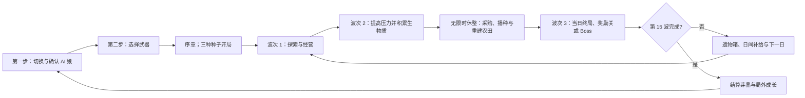

# 《荒穗计划：AI 娘最后一块田》完整游戏设计文档

> 文档版本：BUILD 6.9 · 春天的声音
> 更新日期：2026-10-28
> 文档范围：以当前网页试玩版的实际实现为准，用于策划、程序、测试和后续内容扩展。

## 1. 游戏概述

《荒穗计划：AI 娘最后一块田》是一款俯视角种田战斗 Roguelite。末日后的第 417 天，玩家与一名 AI 娘共同守住人类最后的农区，在五天内寻找并启动种子库。

游戏把 15 个短波次编排进五天：每日前两波负责探索、战斗和积累资源，随后进入一次无限时休整，玩家安全采购种子与道具、切换作物、浇水和重建阵地，再主动开始当日终局。角色脱离成熟作物时只保留基础火力；光环、收获产生的丰收动能与组合植株才会启动插件和流派的完整战斗性能，因此农田是所有构筑的发动机。

### 1.1 核心体验目标

- **种田必须决定战斗。** 裸角色只能维持基础输出；成熟作物、收获动能、杂交和组合植株决定流派能否完整运转。
- **构筑必须产生质变。** 普通插件塑造规则，融合配方让多个插件组合成完整流派，避免只堆攻击数值。
- **强构筑仍要操作。** Boss 会根据玩家构筑评分提高生命，并通过阶段变化、召唤和地面预警压缩安全空间。
- **每局都有节奏峰值。** 收获、角色技能、丰收动能、融合、组合植株和 Boss 转阶段共同制造“突然变强”的爽点。
- **失败仍有进展。** 芽晶可投入局外实验室，逐步增强基础能力和角色技能。
- **角色必须有陪伴感。** 三名 AI 娘拥有不同形象、数值倾向、技能动画和对白，而不是同一角色换色。

### 1.2 单局目标与时长

- 一轮共五天、十五波，完整通关约 8—12 分钟，具体时长取决于 Boss 战和休整使用效率。
- 第 3、8 波为低压奖励关；第 6、12、15 波分别出现三名 Boss。
- 击败第 15 波的“枯穗暴君”即完成远征。
- 死亡或通关都会结算芽晶，记录最高分与远征次数。

## 2. 核心循环与状态逻辑

### 2.0 出发准备：两步确认

主页面采用单人档案式选择。第一步一次聚焦一名 AI 娘：左侧大立绘与展示台，右侧姓名、一句个人台词、两个定位标签及简短技能说明。完整技能数值、被动与专属插件收进“技能与被动详情”，按需展开，不在初始页面堆叠全部说明。

- 点击左右箭头、底部三张头像或按键盘 `← / →` 切换角色，支持首尾循环。切换时旧立绘淡出、新立绘沿切换方向滑入，并配合扫描线和档案文字转场；约 0.48 秒后清理状态。快速切换会以最终选择为准，不会因旧计时器跳回其他角色。
- 第一次确认仅进入“武器整备”，不开始剧情和战斗。第二步以大尺寸动态武器展示为中心，下方五张缩略卡切换武器，右侧只显示当前武器的独特规则、两个标签与同行者确认。
- 在武器页点击“返回同行者”或按 `Esc` 可以重选角色，已选武器保留。确认“开始远征”后才进入所选角色的序章。
- `Enter` 在主确认按钮或页面上执行当前步骤；角色卡、箭头、详情和图标按钮保留自身的键盘操作。键盘左右切换后焦点落回确认按钮，连续两次确认不会由长按重复键自动触发。
- 图鉴与方舟实验室改为右上角书本与芯片图标，悬停或聚焦显示名称，并提供无障碍标签。两者仍使用独立面板，关闭后回到此前准备步骤并保留选择。实验室打开时不会误切人物或武器。
- 尊重系统“减少动态效果”，关闭角色转场与武器页的切换动画。
- 从暂停或结算返回主页面时，重新从“同行者”开始；保留局外成长。

### 2.1 普通波

- 普通计时波从第 1 波的 22 秒开始，每波增加 0.75 秒，第 14 波达到 31.75 秒；每日前两波为白昼，当日第三波为夜间或首领战。逐波延时让后期的跨区经营、杂交与复杂怪群拥有更完整的决策窗口。
- 玩家探索四个分散农区，收集资源并建立作物组合；敌人上限随波内时间平滑提高。
- 夜间的特定怪物可以攻击作物，白昼怪物只攻击玩家。
- 随机事件会在非 Boss 时段出现，改变短期目标。事件生成前会校验“剩余波长 ≥ 事件持续时间 + 1.5 秒”；不满足时保留事件计时到后续波次，已经开始的事件则完整结束后再进入波次结算。

### 2.2 奖励关与首领关

- 第 3、8 波是低压奖励关，时长按 `17 + (波次 - 1) × 0.45` 计算，即 17.9 秒与 20.15 秒。入场至少获得 16 点物流护盾；敌群上限和成长速度显著降低，刷新池移除弹幕怪与精英，所有敌人暂停攻击作物。
- 奖励关结束时固定恢复 18 生命、获得 3 水、8 生物质、全部已解锁种子各 2 颗，并获得 45 点超频。
- 第 6、12、15 波没有强制结束时间，必须击败 Boss；Boss 仍会在 66% 与 33% 生命进入新阶段。
- 每日第三波结束时生成一个必掉遗物箱，每天最多一个。

### 2.3 休整轮

- 每日第 2 波结束后进入无限时休整轮，期间不刷新怪物，并清除残留的普通敌人和敌弹。
- 休整面板出售全部已解锁种子的补给，每次获得 2 颗，价格按作物强度分为 2—5 生物质；同时随机展示一个尚未解锁的种子蓝图，蓝图价为基础 5 加上种子价格高于 2 的差额，解锁后获得 2 颗该种子。蓝图与货郎商品共用刷新按钮和整局递增刷新费；已通过成就解锁的组合卡也只能在这里购买。
- 商店 NPC“阿栓”每次展示四件随机道具，从 21 件商品中抽选。永久器件每局限购一次，三类日常补给每天限购一次；刷新费在整局内依次为 2、4、6……生物质，不因天数重置。
- 玩家仍能自由移动、播种、浇水、收获和开启遗物箱；作物湿度与生长、成熟作物被动、自动滴灌、自动播种和农场主脑灌溉在休整中全部暂停。这样休整保持不限时决策空间，但不能无限刷取阳光、炮火或成熟收益。
- 商店面板可上拉收起为顶部短条，玩家可以看清角色和田地；展开后保留全部商品和当前刷新价格。
- 玩家准备完成后按 `F` 主动进入当日终局，形成“战斗赚钱 → 采购 → 布防 → 主动开战”的闭环。

### 2.4 日间结算

- 恢复 12 点生命。
- 获得 2 点水和 4 点生物质，不直接赠送种子。
- 弹出三选一插件，继续发展当前构筑。
- 播种与战斗状态保留，进入下一天。

### 2.5 胜负条件

- 玩家生命降至 0：远征失败，进入结算。
- 击败最终 Boss：远征成功，进入胜利结算。
- 结算界面和暂停界面都能返回主页面并重新选择同行者；“重新开始”沿用当前角色与武器，直接开启新一局。

## 3. 操作与即时决策

| 输入 | 功能 | 设计目的 |
| --- | --- | --- |
| `WASD` / 方向键 | 移动 | 绕开弹幕、切换农区、积蓄或取消不动流加成 |
| 鼠标移动 | 瞄准 | 决定远程弹道或近战挥砍方向 |
| 按住鼠标左键 | 射击 / 挥砍 | 行为由开局选择的远程武器或月芽收割镰决定 |
| `1`—`8` / 鼠标滚轮 | 切换种子或主动道具 | 数字键直选对应的八种作物；滚轮只在本局已解锁种子和已有主动道具间循环 |
| `E` | 田块互动 / 开箱 / 使用道具 | 空地播种、缺水补水、成熟收获、开启遗物箱或用铲子开垦 |
| `Q` | AI 娘主动技能 | 制造角色专属的战斗与农务强势窗口 |
| `Space` | 冲刺 | 0.18 秒高速移动，并获得短暂无伤判定 |
| `F` | 结束休整 | 玩家确认布防完成后主动开始下一波 |
| `P` | 暂停 | 查看当前构筑或返回主页 |

操作上的主要冲突来自三组选择：继续输出还是去救田、留在作物光环里还是躲开 Boss 技能、站立积蓄炮台增益还是保持移动。

## 4. 世界与农田系统

### 4.1 地图

- 世界尺寸为 2380×1480，屏幕显示区域为 1280×720。
- 摄像机跟随玩家，四个农区分散在地图不同位置。
- 每个农区有 4 块田，共 16 块可用田地。
- 小地图显示玩家、农区、敌群和重要目标，用于规划救田路线。
- 每局随机选择“苔原回潮、锈沙花季、紫孢低地”三种地貌基调之一。四区改为具有顶面、侧壁、坡道与投影的台地：避难所配置小屋和储水罐，温室配置玻璃建筑与叠箱，旧城配置断墙与高架水塔，湿地配置木栈道、芦苇、水洼与树冠。

#### 4.1.1 斜俯视的 2.5D 层次

地图在统一平面战斗坐标上使用分层几何表现立体感，不增加跳跃或真实的垂直碰撞。农区顶面与田块位置保持一致，侧壁向下延伸，坡道和阶梯连接视觉上的高差；移动温室的台地随原生农区移动，独立开垦田不会拖动基座。

| 农区 | 基座宽×深 | 侧壁视觉高度 | 地标 |
| --- | --- | ---: | --- |
| 避难所菜园 | 466×318 | 30 | 带斜屋顶的小屋、储水罐、树木 |
| 破碎温室 | 506×324 | 25 | 玻璃屋顶、结构框架、叠放种子箱 |
| 旧城天台 | 522×344 | 54 | 石砌台壁、残拱、水塔、攀墙植物 |
| 陨坑湿地 | 442×310 | 22 | 湿润台地、斜向木栈道、分层水洼与圆树冠 |

断桥河道增加明暗河岸、侧壁、流动水纹；桥面增加木板、横梁、立柱和桥下阴影，三座可通过桥梁的位置与原逻辑保持一致。断桥日的出生点改为西岸 `(1055, 960)`，避免开局站在断面中受伤。

场景物、人物、敌人、植物、货郎、遗物箱和野外设施按脚下的纵向位置统一排序。玩家走到树后会被树冠覆盖，走到树前则会覆盖树干；若房屋、树、水塔等高物件挡住玩家或活着的敌人，该物件会淡化至约 33%，防止隐藏角色和威胁。友方弹丸、粒子及跳字保持较高显示优先级。停电光照仍使用原来的联合遮罩。

野外设施生成会避开新地标附近；房屋、树木、水箱占据的可见区域不允许开垦新田，避免把植株埋在模型里。原有移动、射击、拾取和农务距离继续使用同一套世界坐标。

| 农区 | 定位 | 生长倍率 | 产量倍率 | 特殊规则 |
| --- | --- | ---: | ---: | --- |
| 避难所菜园 | 初始稳定区 | 1.00 | 1.00 | 靠近出生点，风险最低 |
| 破碎温室 | 快熟区 | 1.35 | 0.90 | 快速形成光环，单次收益较低 |
| 旧城天台 | 高收益区 | 0.90 | 1.35 | 生长较慢，异变概率额外 +11% |
| 陨坑湿地 | 防守区 | 1.10 | 1.15 | 作物护甲倍率 1.35，适合夜间保田 |

四区布局让玩家无法同时照看所有作物。把高价值作物种在远处会获得更高收益，也意味着夜晚必须承担更长的救援路线。

每局开始时会随机打乱四种地形规则，前四天各启用一种且不重复，第五天随机叠加其中两种：

| 地形规则 | 实际逻辑 | 主要决策 |
| --- | --- | --- |
| 断桥田 | 地图中央形成裂谷，只保留三座可通过的窄桥；误入断面会受伤并被推回 | 提前选择跨区路线，避免救田时被裂谷截断 |
| 移动温室 | 破碎温室及其四块田沿椭圆轨道持续移动 | 动态追随成熟光环，重新判断作物阵地位置 |
| 夜间停电区 | 仅在夜晚压缩视野；玩家和成熟向日葵周围保留可视范围 | 用向日葵建立照明点，或承担盲区作战风险 |
| 可争夺灌溉站 | 玩家在中央泵站附近站立 3 秒且没有敌人争夺时完成占领 | 占领后全图补水，并让生长中作物缓慢恢复湿度 |
| 第五日复合地形 | 同时启用两条本轮已出现规则 | 在最终 Boss 战中处理两组地形约束 |

### 4.2 田块状态

田块依次经过：空地 → 生长中 → 成熟。播种时自带 8 点湿度，浇水补至 10 点；湿度耗尽后停止生长。作物基础生命为 100，并受农区护甲与“复合装甲根系”影响。

同一农区种植的种类越丰富，作物成熟时越容易异变。基础异变概率为 4%，每多一种作物增加 4.5%，旧城天台再增加 11%。异变作物的光环强化为 1.35 倍，收获倍率为 2 倍，并拥有更强的自动效果。

开局固定解锁火爆辣椒、向日葵和豌豆炮。其余五种作物不会被永久排除，而是作为随机蓝图随休整商店刷新；购买后立即加入本局种子热栏、补给商店、对应插件池、杂交和组合配方。普通插件池始终按当前已解锁种子过滤，避免种子与天赋不匹配。怪物不直接掉落具体种子，而是掉落通用生物质，让扩充种子库成为明确的经济决策。

种子补给价格按即时战斗价值、成熟时间和组合潜力区分：向日葵 2；火爆辣椒、豌豆炮、铁壳坚果 3；磁力菇、寒冰菇、玉米投手 4；模仿菇 5。每次购买 2 颗。随机蓝图价格对应为 5、6、7、8，避免高联动种子与基础续航种子使用同一成本。

### 4.3 作物与战斗联动

只有成熟作物会持续提供光环。角色进入约 205 像素的作物光环后，普通射击、近战、无人机、叶刃与扎根协议才能获得完整强化。远程武器脱离农田时仅有约 70% 农战转化，近战保留约 98% 基础倍率作为贴身风险补偿；附近成熟作物种类、数量、组合植株以及收获产生的丰收动能会把倍率逐步推高。玩家需要在“留下成熟作物维持阵地”和“收获换取机动强势窗口”之间持续取舍。

| 作物 | 成熟时间 | 直觉对应 | 成熟光环 / 自动效果 | 收获效果 | 适合流派 |
| --- | ---: | --- | --- | --- | --- |
| 火爆辣椒 | 14 秒 | 辣椒清行 | 弹丸命中产生范围爆炸 | 横扫一条宽带内的敌人；融合后连续跳跃爆炸 | 爆炸、弹射、速射 |
| 向日葵 | 16 秒 | 阳光与续航 | 定期生成阳光，阳光可治疗并补充超频 | 恢复生命和护盾；融合后清除附近敌弹 | 护盾、站桩、支援 |
| 豌豆炮 | 18 秒 | 自动射手 | 增加穿透，并自动攻击附近敌人 | 获得短时射速增益 | 穿透、递归弹幕 |
| 磁力菇 | 17 秒 | 吸取金属 | 增强追踪并吸引附近掉落物 | 全图吸取掉落物并清除敌弹 | 追踪、资源回收 |
| 寒冰菇 | 18 秒 | 全场冻结 | 弹丸附加冰冻，成熟作物减速附近敌人 | 冻结全场敌人；融合后追加碎冰伤害 | 控场、叶轮、近战 |
| 模仿菇 | 20 秒 | 复制植物 | 复制最近的非模仿成熟作物，并增加额外弹丸 | 获得短时额外射击数 | 无人机、复合农场 |
| 铁壳坚果 | 19 秒 | 坚果防线 | 降低角色在光环内所受伤害，并为附近田地分摊伤害 | 恢复护盾并修复附近受损田块 | 守田、护盾、不动流 |
| 玉米投手 | 19 秒 | 抛物范围攻击 | 自动投掷爆米花弹，角色弹丸也获得小范围爆炸 | 对多个目标进行范围轰炸 | 群伤、爆燃、控制 |

### 4.4 杂交系统

同一农区内，两株相邻且种类不同的作物有机会在后种作物成熟时完成杂交；异变作物会提高杂交概率。基础杂交率为 30%，异变额外增加 10%；符合配方却失败时会累积本局“育种保底”，下次概率增加 10%，最高额外增加 40%，总概率最高 88%，成功后清零。杂交植株改为双枝嫁接造型：两类成熟果实分居枝端，中央能量核心与双色环标示融合关系，独立名称条继续显示收获提示。成熟后仍可收获；除原有即时效果外，每种杂交还会提供一项最多叠加 5 次的本局属性。杂交记录会永久写入图鉴，首次发现奖励 2 芽晶。种子库的解锁顺序让每局早期配方不同；愿意投入生物质和刷新费的玩家可在后期覆盖全部配方。

| 杂交作物 | 配方 | 质变效果 |
| --- | --- | --- |
| 日灼辣椒 | 火爆辣椒 + 向日葵 | 补盾并释放灼热冲击；收获攻击力 +3% |
| 蒸汽冰椒 | 火爆辣椒 + 寒冰菇 | 形成冷热控制带；收获所受伤害 -3% |
| 棱光豌豆 | 向日葵 + 豌豆炮 | 释放八向光弹；收获暴击率 +2% |
| 磁轨豌豆 | 豌豆炮 + 磁力菇 | 强追踪与穿透；收获移动速度 +2% |
| 镜霜双生菇 | 寒冰菇 + 模仿菇 | 全场碎冰伤害；收获闪避率 +2% |
| 双生日葵 | 向日葵 + 模仿菇 | 补盾并补充超频；收获最大生命 +4 |
| 日光堡垒 | 向日葵 + 铁壳坚果 | 更快生成护盾并提高田地分摊；收获减伤并修复周围田地 |
| 爆燃玉米 | 火爆辣椒 + 玉米投手 | 范围玉米弹升级为大范围灼热爆炸；收获攻击力 +2.5% |
| 冰霜爆米花 | 寒冰菇 + 玉米投手 | 范围爆炸附带冻结；收获暴击率 +1.5% |

### 4.5 成就组合卡与组合植株

组合植株是比普通杂交更稳定、更强的长期目标。玩家先在多局游戏中完成收获或育种成就，永久解锁对应组合卡；每局仍需在休整轮支付生物质购买该卡，再把两株指定的相邻成熟作物合成。合成会消耗供体，主田块变为拥有独立设施外形、可持续自动工作且仍可收获的组合植株。四类设施现分别采用双管履带豆炮、旋转十二瓣聚光塔、冷热双仓反应炉和带轮重型玉米炮造型，并带有机械底座、发光核心与轻量动态，避免继续复用普通果实。玩家需要在保留持续火力与收获本局永久属性之间取舍；每种组合属性最多叠加 3 次，防止能力泛滥。

| 组合植株 | 作物配方 | 永久解锁条件 | 单局卡价 | 一加一大于二的效果 |
| --- | --- | --- | ---: | --- |
| 双联豆炮 | 豌豆炮 + 豌豆炮 | 累计收获 6 株豌豆炮 | 4 生物质 | 每 3 秒发射高伤重豆弹；收获攻击力 +10% |
| 聚光向日塔 | 向日葵 + 向日葵 | 累计收获 6 株向日葵 | 4 生物质 | 每 4 秒生成阳光、护盾与动能；收获最大生命 +12 |
| 冷热反应炉 | 火爆辣椒 + 寒冰菇 | 累计培育 3 株自然杂交作物 | 5 生物质 | 周期冷热冲击与冻结；收获所受伤害 -10%、闪避 +3% |
| 玉米加农炮 | 玉米投手 + 玉米投手 | 累计收获 6 株玉米投手 | 5 生物质 | 每 4 秒发射超重爆米花炮弹；收获攻击力 +6%、暴击 +2.5% |

首次建成每一种组合植株奖励 3 芽晶并写入图鉴。成就只负责永久解锁配方，组合卡和作物材料仍需每局重新取得。

## 5. AI 娘角色设计

角色选择决定一局的开局节奏和主动技能。局外“陪伴模块”会提高技能强度，并缩短技能冷却。

### 5.1 小芽 AI-07

- **定位：** 农田协同、均衡成长。
- **被动：** 作物战斗光环效果提高 18%。
- **主动“丰收编译”：** 约 560 范围内的生长中作物推进 58% 生长进度；成熟作物各发射 5 枚穿透种子。附近没有作物时，为本局全部已解锁种子各补充 1 颗。
- **基础冷却：** 19 秒。
- **动画反馈：** 绿色扩散环、叶片粒子和田块脉冲。
- **推荐构筑：** 递归豌豆、自动农场、镜像农场、作物混合流。

### 5.2 霹雳 BEAT-02

- **定位：** 高爆发、速射清场。
- **被动：** 攻击伤害 +12%，射击间隔 -10%；作物生长速度略慢。
- **主动“雷暴节拍”：** 对 500 范围内敌人造成雷击，并强制进入约 6.5 秒超频。
- **基础冷却：** 18 秒。
- **动画反馈：** 闪电链、全屏闪光、强烈震屏与电弧残影。
- **推荐构筑：** 辣椒弹射、磁暴追踪、不动炮台。

### 5.3 奶泡 MOCHI-11

- **定位：** 护盾、灌溉与容错。
- **被动：** 初始护盾 20，作物生长速度 +25%，作物光环 +8%，自身伤害略低。
- **主动“泡泡温室”：** 获得 28 点护盾并恢复 14 点生命，灌溉全部田块、推进 22% 生长进度，并清除 360 范围内敌弹。
- **基础冷却：** 22 秒。
- **动画反馈：** 泡泡罩、蓝色水波和全田灌溉脉冲。
- **推荐构筑：** 太阳能防火墙、生命收割、永冻叶轮。

### 5.4 角色专属插件与个人结局

每日结算的插件选择会优先放入当前角色仍可升级的专属插件，其他角色无法取得。通关文案也按角色分别结算。

| 角色 | 专属插件 | 两级效果 | 个人结局主题 |
| --- | --- | --- | --- |
| 小芽 | 递归丰收指令 | 每级提高丰收编译 18% 效率，并增加成熟作物齐射数量 | 删除旧有最高产量指令，把“陪你看完发芽”设为新任务 |
| 霹雳 | 安可超频模块 | 每级提高雷击伤害与强制超频时长 16% | 用灌溉泵和风扇写出新世界第一首歌，引导幸存者来到农田 |
| 奶泡 | 软体温室协议 | 每级提高护盾、治疗与催熟效果 18% | 修改护理数据库，确认希望虽然营养未知，却能让人活到下一顿饭 |

## 6. 战斗系统

### 6.1 基础属性

- 初始生命 100；备份模块每级增加 7 点生命。
- 初始远程伤害为 17，再乘角色倍率、农战转化与局外共生算力；没有成熟作物或丰收动能时只发挥基础火力。
- 初始射击间隔 0.205 秒，暴击率 5%，暴击伤害 1.75 倍。
- 初始移动速度 220，冲刺基础冷却 2.35 秒。
- 经验升级需求从 36 开始，之后约为 `36 + 当前等级 × 18`。

### 6.2 远程攻击

弹丸可由插件获得多发、弹射、追踪、穿透、爆炸和冰冻。弹射会搜索 310 范围内的新目标；被冻结的敌人受到额外 22% 伤害。成熟作物光环在开火时写入弹丸，因此玩家的位置直接决定这一发子弹拥有何种效果。

开局直接选择五种主武器之一。武器不仅拥有基础伤害、射速和射程差异，还各自携带一条独立攻击规则，并只把与当前武器兼容的专精放入升级池。

| 武器 | 基础定位 | 独特规则与专精 |
| --- | --- | --- |
| 脉冲步枪 | 均衡连射 | 每第 6 次射击产生金色过载弹，造成 2.2 倍伤害并额外穿透；“过载电容”强化威力，满级改为每 5 次触发 |
| 孢子霰弹枪 | 近距爆发 | 一次发射 5 枚孢子；165 距离内命中额外造成 55% 伤害和小范围孢爆；“菌盖收束器”提高倍率与距离 |
| 根系轨道枪 | 慢射贯穿 | 2.55 倍基础伤害、自带 3 次穿透；每贯穿一个仍存活目标，弹体伤害提高 18%；“根轨电感”提高成长并延长弹体寿命 |
| 共生法杖 | 追踪分裂 | 主法球首次命中分裂出两枚追踪芽弹，作物光环强度 ×1.18；“分芽棱镜”提高芽弹倍率，满级额外增加一枚 |
| 月芽收割镰 | 宽幅近战 | 直接以近战开局，扇形群攻并击退普通怪；“月芽磨盘”提高刀程和倍率，且可与辣椒核心完成生命收割融合 |

### 6.3 近战攻击

选择“月芽收割镰”后，主攻击从开局起就是扇形挥砍，近战不占用任何天赋位：

- 基础范围 122，基础扇角约 112°，基础间隔 0.40 秒；内置 1.20 武器倍率与 1.92 近战系数，保留足够的贴身风险补偿。
- 一次攻击可命中扇区内所有敌人，并击退普通敌人。
- 近战保留较高裸倍率；成熟豌豆扩大刀程与伤害，辣椒触发范围爆破，向日葵扩大扇角并提高暴击，寒冰菇附加冻结，模仿菇追加回声斩。
- “丰收磨刀石”让丰收动能进一步提高挥砍速度；只有靠近成熟作物或保有丰收动能时，群体命中才能获得有限回复。
- 完成“生命收割回路”后，辣椒农能进一步扩大范围，并根据群体命中回复更多生命。

### 6.4 不动流蓄力

角色只有靠近成熟作物或拥有丰收动能时，静止才能逐步积蓄稳定度，基础 3 秒充满；移动时以约 2.7 倍速度衰减。稳定度会同时提供伤害、攻速和减伤，“根系反冲架”可缩短充满时间。完成“固定丰收炮台”后，满蓄力追加伤害，并持续恢复护盾。

这一流派的主要风险是 Boss 地面技能。高伤害来自主动选择站位，而不是无条件常驻。

### 6.5 护盾与受击反馈

护盾优先吸收伤害。护盾被打碎时会触发白色闪屏、破碎圆环、粒子、文字、音效和短震屏，并冻结附近敌人约 1.25 秒。该反馈既提示防线失效，也给玩家一个撤离窗口。

### 6.6 连击、丰收动能与爽感超频

- 连续击杀会累积连击，2.6 秒未续上则中断。
- 连击提高得分倍率；达到 10、20、35 连击时额外掉落资源。
- 击杀本身不再增加超频或提供直接战斗强化；经验升级会推进田间生长并补充灌溉水，把成长重新导向农务。
- 每次收获获得 1 层丰收动能，最多 6 层；12 秒后开始每 3 秒衰减 1 层。动能提高农战转化，并按插件启动攻速、追踪、弹射、无人机、叶刃和扎根能力。
- 收获增加 9 点超频，向日葵、磁轨豌豆与聚光向日塔可以追加补充；击败 Boss 仍会补满，作为阶段胜利反馈。
- 超频达到 100 后持续 8 秒，攻击间隔乘 0.62、移动速度乘 1.18、作物生长速度翻倍，最长可延长至 11 秒。

## 7. 局内成长系统

### 7.1 升级选择规则

玩家升级和每日结算会获得三选一插件。普通等级不会直接增加通用伤害、护甲、移速或闪避；插件改为改变收获、成熟光环、丰收动能、农具和武器独特规则，并同时按本局已解锁种子与当前武器过滤。系统会优先放入当前高进度插件或可组成融合的互补插件；近战从开局武器确定，不再作为升级选项出现。

当等级达到 3、6、9……时，本次选择替换为“三级属性节点”，只会出现战术增幅（攻击 +7%）、复合护甲（受伤 -5%）、伺服步态（移速 +5%）和相位闪避（闪避 +3.5%，上限 24%）中的三项。普通插件主要改变攻击和农田规则；每日终局遗物箱和商店强力道具提供更稀有的底层参数。

### 7.2 普通插件

| 插件 | 上限 | 主要效果 |
| --- | ---: | --- |
| 光合节拍器 | 3 | 每层丰收动能额外缩短射击与挥砍间隔 |
| 双生芽孢 | 2 | 附近每存在两类成熟作物，增加一枚弹丸 |
| 弹射藤蔓 | 2 | 辣椒、模仿菇光环或高丰收动能启动额外弹射 |
| 导航花粉 | 3 | 磁力菇、模仿菇光环或丰收动能启动追踪 |
| 辣椒燃烧芯 | 3 | 扩大辣椒爆炸范围并略增作物收益 |
| 阳光缓存 | 3 | 提高向日葵治疗、护盾和超频收益 |
| 豌豆训练 | 3 | 提高豌豆自动攻击与收获射速收益 |
| 果皮防火墙 | 2 | 每次收获恢复少量护盾 |
| 过载电容 | 3 | 步枪专属，提高过载弹伤害与穿透，满级缩短触发周期 |
| 菌盖收束器 | 3 | 霰弹枪专属，提高贴脸孢爆伤害与有效距离 |
| 根轨电感 | 3 | 轨道枪专属，提高贯穿后的伤害成长、穿透和弹体寿命 |
| 分芽棱镜 | 3 | 法杖专属，提高芽弹伤害，满级增加分裂数量 |
| 月芽磨盘 | 3 | 镰刀专属，提高挥砍范围、近战倍率与作物刀刃效果 |
| 丰收磨刀石 | 3 | 丰收动能提高挥砍速度，并扩大扇形角度 |
| 扎根协议 | 3 | 只在作物或丰收动能链接下蓄力，提高伤害、攻速和减伤 |
| 根系反冲架 | 2 | 缩短农田阵地内的扎根蓄力时间 |
| 守田无人机 | 3 | 只在作物或丰收动能链接下自动索敌 |
| 量子水壶 | 3 | 提高作物生长速度并补充水 |
| 脉冲滴灌器 | 2 | 每 10.5 / 8 秒为一株缺水作物补水，消耗 1 水 |
| 单格播种机 | 2 | 每 13 / 10 秒在角色附近播种一格，消耗当前种子且不收获 |
| 拾荒磁芯 | 2 | 扩大角色拾取范围 |
| 果冻土壤 | 3 | 提高作物抗性 |
| 磁菇线圈 | 3 | 强化磁力菇追踪与回收能力 |
| 寒冰菌核 | 3 | 强化寒冰持续时间和冻结收益 |
| 模仿菌丝 | 3 | 强化模仿效果与额外弹丸 |
| 坚果缓冲层 | 3 | 强化坚果对人物和田地的减伤、护盾与修复能力 |
| 爆米花药室 | 3 | 强化玉米投手的伤害、爆炸半径和收获轰炸 |
| 环绕叶刃 | 3 | 作物或丰收动能链接时生成自动绕身攻击的叶片 |
| 递归丰收指令 | 2 | 小芽专属，提高丰收编译效率与齐射数量 |
| 安可超频模块 | 2 | 霹雳专属，提高雷暴伤害与超频时长 |
| 软体温室协议 | 2 | 奶泡专属，提高泡泡温室的护盾、治疗和催熟 |

### 7.3 关键遗物

| 遗物 | 效果 | 构筑意义 |
| --- | --- | --- |
| 心种核心 | 最大生命 +30，并恢复 30 | 提高近战与站桩容错 |
| 收成校准核心 | 每次收获增加一层本局农战转化，最多 15 层 | 把永久战斗增益绑定到实际收获 |
| 液压足具 | 移速 ×1.10，冲刺冷却 ×0.88 | 提高远程走位和 Boss 容错 |
| 共鸣电池 | 技能冷却 ×0.84，技能强度 ×1.10 | 放大角色特色 |
| 种子保险库 | 生长速度 ×1.18，收获倍率 ×1.15 | 农田构筑核心 |
| 采集透镜 | 经验倍率 ×1.18，拾取范围 +55 | 提前成型并改善资源手感 |

### 7.4 商店 NPC 与主动农具

阿栓只在休整轮开放交易，默认每次库存四件，从 21 件当前可购买商品中不放回抽取。永久器件每局限购一次；雨水罐、便当和种子盲盒每天各限购一次，下一天重新进入随机商品池。刷新不能绕过限购。属性可能与当前构筑不完全匹配；刷新次数在整局共享，价格严格按 `2 + 2 × 已刷新次数` 计算，即 2、4、6、8……。商品显示图案、效果、价格与农务／补给／探索／武装分类；四件货物采用两列布局，长内容可滚动，面板仍可上拉收起。

| 商品 | 价格 | 效果 |
| --- | ---: | --- |
| 折叠开荒铲 | 7 | 主动道具，5 点耐久；切换后按 `E` 在当前位置开垦独立田块，河床、桥面及过密位置不可挖 |
| 赤红增幅器 | 12 | 攻击力 +8% |
| 甲壳复合板 | 11 | 所受伤害 -7% |
| 蜻蜓伺服靴 | 10 | 移动速度 +7% |
| 概率斗篷 | 12 | 闪避率 +5%，最高 30% |
| 露珠瞄准镜 | 10 | 暴击率 +4% |
| 罐装心跳 | 11 | 最大生命 +16，并恢复 16 |
| 风切扳机 | 13 | 远程与近战基础攻击间隔 -6% |
| 慢释星尘肥 | 10 | 作物生长 +5%，收获收益 +7% |
| 低温冷却液 | 12 | 冲刺冷却 -8%，AI 技能冷却 -6% |
| 拼装种子袋 | 8 | 当前已解锁的每类种子 +1 |
| 田地修补箱 | 9 | 全部田块恢复满耐久，作物抗击打 +8% |
| 回收雨水罐 | 6 | 水 +3；每日限购一次 |
| 避难所便当 | 8 | 恢复 22 生命，不超过最大生命；每日限购一次 |
| 盲盒种子包 | 7 | 随机一种已解锁种子的库存 +3；每日限购一次，不解锁新种子 |
| 嫁接花蜜 | 11 | 下一次杂交保底加成 +16%，保底总值上限 40%；成功杂交后清零 |
| 菌床堆肥芯 | 13 | 生长 +4%、收获收益 +3% |
| 保水种壳 | 10 | 播种与手动浇水额外获得 2 点湿度；不推进休整生长 |
| 六穗丰收护符 | 12 | 未来 6 次收获各获得护盾 +4、生物质 +1；护盾总值最多 70 |
| 旧世勘探罗盘 | 9 | 拾取范围 +18、野外设施互动距离 +18 |
| 纤维稳压握把 | 15 | 远程与近战基础攻击间隔 -3% |

铲子加入滚轮热栏，与本局全部已解锁种子共同循环。它允许玩家针对移动温室、断桥岸线或 Boss 安全区临时扩建阵地，初始五点耐久使原有四农区仍然重要，少量随机工作台可补充开垦次数。开垦田块标记为独立田，不参与原农区中心与移动温室轨迹的计算；因此挖地只新增田块，不会再拖动农区底板、标牌、商人或原有田块。

### 7.5 九种融合配方

| 融合 | 配方 | 质变效果 |
| --- | --- | --- |
| 超辣链式反应 | 辣椒燃烧芯 3 + 弹射藤蔓 2 | 收获辣椒后在多个敌人之间连续爆炸 |
| 太阳能防火墙 | 阳光缓存 3 + 果皮防火墙 2 | 附近有成熟向日葵时护盾恢复；收获时清除附近敌弹并补盾 |
| 递归豌豆算法 | 豌豆训练 3 + 光合节拍器 3 | 豌豆光环或丰收动能下，击杀向四周发射 6 枚追踪弹 |
| 全自动农场主脑 | 守田无人机 3 + 量子水壶 3 | 无人机双发，每 5 秒自动灌溉一块缺水田 |
| 磁暴追猎协议 | 磁菇线圈 3 + 导航花粉 3 | 磁力菇光环或丰收动能下获得强追踪，磁力菇收获强化 |
| 永冻叶轮 | 寒冰菌核 3 + 环绕叶刃 3 | 叶刃附加冻结；寒冰菇收获追加全场碎冰伤害 |
| 镜像农场集群 | 模仿菌丝 3 + 守田无人机 3 | 模仿光环和无人机同时增加弹丸 |
| 生命收割回路 | 月芽磨盘 3 + 辣椒燃烧芯 3 | 辣椒农能扩大挥砍，群体命中时吸取生命 |
| 固定丰收炮台 | 扎根协议 3 + 量子水壶 2 | 靠近成熟作物蓄满后追加伤害，并持续恢复护盾 |

### 7.6 每日荒野设施

每日开始时重抽设施，前一日设施退场。地图有 10 个经过筛选的候选位置，每次打乱后检查前 5 个；每个候选位置有 72% 概率生成，默认每天最多 4 处。每种设施当天最多出现一次；每个位置从剩余类型按相对权重抽取，权重并非固定百分比。允许当天没有设施，不保证某一具体类型出现。

位置避开中央河床、原生田块、立体建筑、树木、灌溉站及温室主要轨道；距当前田块不足 155 的位置会跳过。每处在小地图显示菱形，靠近后显示名称、价格、效果和 `E` 提示。互动默认范围 70；罗盘可增加 18。遗物箱优先响应，其余按距离在设施与田块之间选择，防止一次按键同时触发两种操作。

| 设施 | 相对权重 | 消耗 | 一次性收益 |
| --- | ---: | --- | --- |
| 雨水收集桶 | 1.3 | 免费 | 水 +2 |
| 堆肥交换机 | 1.1 | 水 ×1 | 生物质 +4，需权衡灌溉储备 |
| 田间种子柜 | 1 | 生物质 5 | 柜中标明的一种已解锁种子 +3、水 +1；种子种类在当天生成时确定 |
| 旧世记忆终端 | 0.7 | 生物质 3 | 永久芽晶 +1，触发所选 AI 娘的个人记忆对白 |
| 废弃工作台 | 0.95 | 生物质 4 | 开荒铲耐久 +2，上限 5；没有铲子时组装一把 2 耐久铲子 |
| 授粉风铃 | 0.8 | 生物质 3 | 未来 3 次收获各额外获得生物质 +1、超频 +2 |

设施使用后会变灰并标记“已使用”，不会重复发奖。钱不足、水不足或铲子已满时不扣资源，也不消耗设施。修铲的新增耐久是有限设施奖励，因此每把铲子的当前耐久仍不超过 5，但单局开垦总次数可通过工作台补充。设施周围 88 距离内不能开新田，以保留操作空间。

授粉风铃与丰收护符均按“实际完成一次收获”消耗一次，普通、杂交与组合植株均支持；组合设施由两株合成，但收获只计算一次。两种奖励可以同时生效。剩余次数显示在分页构筑栏中。野外收益以补给、交换、农务后效和旅伴叙事为主，不直接提供大量永久战斗属性。

## 8. 主要流派设计

流派不是开局锁定的职业，而是玩家通过插件、遗物、角色和作物组合主动形成的战斗循环。

### 8.1 辣椒弹射爆炸流

- **核心：** 辣椒燃烧芯、弹射藤蔓、双生芽孢、光合节拍器。
- **完成形态：** 超辣链式反应。
- **推荐角色：** 霹雳或小芽。
- **循环：** 在成熟辣椒附近射击制造连续范围爆炸，敌群聚集时收获辣椒触发全场链爆。
- **优势：** 清杂极快，连击容易维持。
- **弱点：** 对单体 Boss 的效率依赖射速与弹射目标数量。

### 8.2 递归豌豆弹幕流

- **核心：** 豌豆训练、光合节拍器、双生芽孢；后期可建双联豆炮。
- **完成形态：** 递归豌豆算法。
- **推荐角色：** 小芽或霹雳。
- **循环：** 成熟豌豆提供穿透和自动火力，首次击杀触发六向弹幕，再由弹幕继续制造击杀。
- **优势：** 敌群越密，连锁效率越高。
- **弱点：** 缺少杂兵时，对单体伤害回落。

### 8.3 磁暴追踪流

- **核心：** 导航花粉、磁菇线圈、双生芽孢、拾荒磁芯。
- **完成形态：** 磁暴追猎协议。
- **推荐角色：** 霹雳。
- **循环：** 围绕成熟磁力菇倾泻追踪弹，收获后借丰收动能继续移动追击，同时清弹并回收全图资源。
- **优势：** 操作压力低，资源回收稳定，适合高速移动。
- **弱点：** 单发爆发较低，依赖持续输出。

### 8.4 永冻叶轮流

- **核心：** 寒冰菌核、环绕叶刃、量子水壶。
- **完成形态：** 永冻叶轮。
- **推荐角色：** 奶泡。
- **循环：** 在成熟寒冰菇附近让叶轮持续冻结，危险时收获寒冰菇全屏控场，再借丰收动能维持短时叶轮追击。
- **优势：** 控场强，能保护田地和创造救援时间。
- **弱点：** 需要贴近敌群，叶轮未成型时伤害偏低。

### 8.5 全自动镜像农场流

- **核心：** 守田无人机、量子水壶、模仿菌丝。
- **完成形态：** 全自动农场主脑 + 镜像农场集群。
- **推荐角色：** 小芽或奶泡。
- **循环：** 自动灌溉维持多区作物，无人机和模仿光环增加弹量，小芽负责批量催熟。
- **优势：** 农务压力低，地图覆盖广，后期视觉与火力成长明显。
- **弱点：** 需要较多高等级插件，成型较慢。

### 8.6 太阳能护盾流

- **核心：** 阳光缓存、果皮防火墙、量子水壶；后期可建聚光向日塔。
- **完成形态：** 太阳能防火墙。
- **推荐角色：** 奶泡。
- **循环：** 围绕成熟向日葵战斗，收集阳光维持生命和超频，利用收获清除 Boss 弹幕。
- **优势：** 容错高，适合学习 Boss 招式。
- **弱点：** 直接输出成长较慢，需要副输出插件。

### 8.7 生命收割近战流

- **核心：** 开局选择月芽收割镰，以月芽磨盘、丰收磨刀石、辣椒燃烧芯为成长主线，辅以寒冰菇控场。
- **完成形态：** 生命收割回路。
- **推荐角色：** 奶泡，次选霹雳。
- **循环：** 先在田间收获积累动能，再冲刺切入；豌豆扩大刀程、辣椒引爆群体、寒冰控制敌群，作物链接下的群体吸血抵消贴身风险。
- **优势：** 群体伤害和恢复能力强，攻击方式与远程流完全不同。
- **弱点：** Boss 接触伤害高，必须熟悉冲刺时机和地面预警。

### 8.8 固定丰收炮台流

- **核心：** 扎根协议、根系反冲架、量子水壶、向日葵。
- **完成形态：** 固定丰收炮台。
- **推荐角色：** 霹雳。
- **循环：** 在成熟作物光环和安全地形中站立蓄满稳定度，以高攻速高减伤输出；看到预警后冲刺换位并重新架设。
- **优势：** 对 Boss 单体输出高，满蓄力反馈明确。
- **弱点：** 地面危险区和高速近身敌人会频繁打断蓄力。

## 9. 敌人设计

敌人的作用不只是提高伤害，而是分别攻击玩家的走位、农田、资源和目标优先级。

| 敌人 | 首次主要出现 | 行为 | 玩家对策 |
| --- | ---: | --- | --- |
| 啃根虫 | 第 1 天 | 直接追击，夜间常攻击田地 | 基础走位与快速清理 |
| 吐籽怪 | 第 1 天 | 保持距离并发射子弹 | 横向移动或追踪弹处理 |
| 冲撞野猪 | 第 2 天 | 近距离加速冲撞，对田块伤害更高 | 提前击杀或用冰冻打断接近 |
| 飞刺蜂 | 第 2 天 | 高速追击，体型小 | 多发、爆炸和自动武器 |
| 吸能蛭 | 第 3 天 | 中速持续压迫 | 控场后集中输出 |
| 掠种贼 | 第 3 天 | 优先寻找成熟田块，偷走后加速逃跑 | 看到提示立即转火或提前收获 |
| 故障兽 | 第 3 天 | 周期性加速，死亡后分裂出飞刺蜂 | 保留范围伤害处理分裂物 |
| 臃肿孢体 | 第 4 天 | 高生命，远程攻击，死亡时发射环形弹幕 | 拉开距离并预留躲弹空间 |
| 修复者 | 第 4 天 | 为 245 范围内同伴恢复生命 | 始终作为高优先级目标 |

普通敌人的生命会随本局经过时间和天数共同增长，伤害与速度随天数上升。为降低突然堆怪，敌人上限采用平滑时间函数：`时间压力 = 2.8 × ln(1 + 经过秒数 / 35) + 1.4 × √(经过秒数 / 60)`；白昼上限约为 `7 + 时间压力 + 2 × (日数 - 1)`，夜晚基数改为 12。刷新间隔再除以一个缓慢增长的压力系数，因此前期更疏、后期逐渐加快。

普通刷新池使用权重而非等概率抽取。啃根虫、野猪等近身单位占多数，第五日吐籽怪与飞刺蜂两类弹幕单位合计权重约为 `3 / 18`，避免普通战斗长期被远程弹幕覆盖；Boss 的机制弹幕保持不变。

植物只有在夜晚能够受到伤害。普通怪物中只有啃根虫、冲撞野猪和掠种贼会主动选择田块；“腐田”精英和“噬田根冠”最终 Boss 变体是额外的极少数例外。其他敌人始终只追击玩家，避免整张地图的植物同时无差别掉血。

普通敌人生成时有约 6.5%—14.5% 的概率获得一个精英词缀，概率随天数提高并在 15% 封顶：

| 精英词缀 | 效果 | 对策 |
| --- | --- | --- |
| 狂暴 | 移速 +35%，伤害 +15% | 优先控制和击杀，避免贴身 |
| 装甲 | 生命 +80%，移速 -14% | 留到低威胁窗口持续输出 |
| 分裂 | 死亡后生成两只啃根虫 | 用范围攻击处理死亡位置 |
| 虹吸 | 命中玩家后恢复生命 | 避免交换伤害 |
| 腐田 | 获得夜间攻击植物资格，伤害 +18% | 与掠种贼同为最高守田优先级 |

## 10. Boss 设计

### 10.1 通用规则

- Boss 基础生命会根据构筑评分自适应。评分参考已取得插件等级、融合数量、遗物数量和理论秒伤，生命倍率限制在约 1.0—2.45 之间。
- 玩家对 Boss 的最终伤害乘 0.72，单次伤害不能超过 Boss 最大生命的 3.2%，避免天胡构筑瞬间跳过机制。
- Boss 在 66% 和 33% 生命时进入新阶段：移动速度、接触伤害、技能频率和召唤数量提高。
- 出场时有约 2.2 秒镜头与标题演出。
- 强力招式先显示红、绿或紫色地面预警，再结算伤害；玩家需要根据形状选择安全区。
- 每名 Boss 登场时会随机选择两种变体之一，变体名称、说明和首次发现会显示在出场演出与图鉴中。

### 10.2 Boss 变体

| 本体 | 变体 | 变化 |
| --- | --- | --- |
| 乱码鸦王 | 暴风羽冠 | 飞行速度 +18%，扇形羽弹增加并提高弹速 |
| 乱码鸦王 | 铁喙协议 | 生命 ×1.32、碰撞伤害 ×1.25，移动略慢且召唤增加 |
| 缓存史莱姆 | 强酸缓存 | 腐蚀区半径 ×1.28，技能冷却缩短 |
| 缓存史莱姆 | 群落备份 | 生命 ×1.18，每次额外召唤 3 只吸能蛭 |
| 枯穗暴君 | 日蚀核心 | 战斗强制进入停电视野，年轮技能频率提高 |
| 枯穗暴君 | 噬田根冠 | 生命 ×1.25，年轮会额外预警并腐蚀最多两块作物 |

### 10.3 第 6 波：乱码鸦王

- **基础生命：** 3200，再乘自适应倍率。
- **战斗主题：** 高速位移、扇形弹幕、直线封锁。
- **普通攻击：** 朝玩家发射 7 枚扇形羽弹；低血量时追加 8 枚环形弹。
- **技能“俯冲校验”：** 预警三条略有夹角的长直线，约 0.95 秒后沿线造成伤害。
- **召唤：** 召唤飞刺蜂，阶段越高数量越多。
- **考查能力：** 横向走位、冲刺时机、快速处理高速小怪。
- **设计意图：** 第一名 Boss 主要检验基础移动，不要求玩家理解复杂安全区。

### 10.4 第 12 波：缓存史莱姆

- **基础生命：** 6200，再乘自适应倍率。
- **战斗主题：** 环形弹幕、腐蚀区域、持续压缩活动空间。
- **普通攻击：** 发射 12 枚旋转环形弹；半血以下增加到 18 枚并提高弹速。
- **技能“缓存溢出”：** 在玩家附近连续生成 3 个腐蚀圆，半血以下增加到 5 个；各圆分时爆发。
- **召唤：** 召唤吸能蛭。
- **考查能力：** 预判落点、连续换位、清理召唤物时保持对 Boss 输出。
- **设计意图：** 强迫站桩流学会“短时架设—及时转移”，并考验农田位置选择。

### 10.5 第 15 波：枯穗暴君

- **基础生命：** 11200，再乘自适应倍率。
- **战斗主题：** 综合毕业考试、内外圈安全区、混合召唤。
- **第一形态：** 发射 7 枚高速瞄准扇形弹。
- **第二形态：** 55% 生命以下改为 18 枚旋转环形弹，并显著提高频率。
- **技能“枯萎年轮”：** 同时预警中心圆和外圈，要求玩家进入两者之间的安全带。
- **召唤：** 混合召唤吐籽怪和臃肿孢体。
- **考查能力：** 读预警、控制召唤物、保留技能清弹、利用农田光环输出。
- **设计意图：** 同时检验五天中学到的走位、目标排序、构筑协同和资源管理。

## 11. 五日关卡设计

当前版本采用“一张持续大地图 + 每日地形规则轮换 + 15 波固定骨架 + 敌人组合变化”的关卡结构。每日第 2 波之后都有一次无限时休整，让玩家把战斗所得生物质转化为种子、道具和农田阵地，并自主决定何时开始当日终局。

| 日数 | 波次 | 休整与地形 | 当日终局 | 主要教学 / 检验 |
| --- | --- | --- | --- | --- |
| 第 1 天 | 1—3 | 第一个随机地形；第 2 波后首次采购与播种 | 第 3 波低压奖励关 | 建立“战斗赚钱、休整种田”，再领取明确奖励的认知 |
| 第 2 天 | 4—6 | 第二个不重复地形；第 5 波后调整阵地 | 第 6 波随机变体乱码鸦王 | 冲刺、扇形弹幕、直线预警 |
| 第 3 天 | 7—9 | 第三个地形；第 8 波先给奖励，第 8 波后休整 | 第 9 波复合敌群守田 | 目标优先级、跨区救田、分裂处理 |
| 第 4 天 | 10—12 | 第四个地形；第 11 波后完成后期构筑 | 第 12 波随机变体缓存史莱姆 | 环形弹幕、连续危险区、转移阵地 |
| 第 5 天 | 13—15 | 随机叠加两个既有地形；第 14 波后最终整备 | 第 15 波随机变体枯穗暴君 | 对整套系统的综合检验 |

### 11.1 趣味关卡来源

- **田地分散：** 玩家必须为远处高收益农区承担路程和失守风险。
- **特殊怪物：** 偷田、治疗、分裂、死亡弹幕改变击杀顺序。
- **Boss 地形题：** 直线、连续圆形和内外年轮分别要求不同移动方式。
- **每日地形：** 断桥、移动温室、停电和灌溉争夺会改变路线、视野或阵地位置。
- **随机事件：** 在固定五日骨架中插入资源窗口或突发敌潮。
- **构筑地形：** 成熟作物的光环会让玩家自己建立临时“阵地”，每局有效战斗区域不同。

## 12. 随机事件

随机事件初始计时约 44 秒，首次事件后每次间隔随机为 72—100 秒；Boss 战、奖励关和休整轮中不会触发。事件横幅只显示 4.8 秒，效果可继续生效，避免长期遮挡小地图和战场。事件准备触发时会读取当前波剩余秒数；不足以覆盖完整事件和 1.5 秒结算余量时暂不启动。已经启动的事件拥有高于波次截止的收尾优先级，事件结束的同一帧再进入休整或下一波。

| 事件 | 持续 / 结果 | 即时决策 |
| --- | --- | --- |
| 生物质雨 | 在玩家附近散落 6 份、每份价值 3 的大额通用生物质 | 抢资源，为下一次休整采购更多种子；减少屏幕碎片数量 |
| 生长季风 | 15 秒内作物生长速度 ×3 | 快速播种并跨区灌溉 |
| 害兽团建 | 立即生成 8 只复合敌人 | 用于高风险刷经验，也可能冲垮田区 |
| 磁极反转 | 14 秒内全图大范围吸取掉落物 | 趁机远行，不必回头捡资源 |

## 13. 掉落、经济与结算

普通敌人死亡会生成一份整合经验，并有机会生成水和通用生物质，不再直接掉落任何具体种子。经验价值为原怪物经验的 1.18 倍；水基础概率 12%、单份价值 2，生物质基础概率 30%、单份价值 2，并受局外雷达模块影响。82 像素内同类型、同变体掉落会自动合并数值、刷新存留时间，并以尺寸和 `×N` 徽标表现堆叠；Boss 奖励也由十二个碎片压缩为五个大额对象。掉落物先减速悬浮，再在进入磁吸范围后飞向玩家，避免资源始终向屏幕下方坠落；断桥田启用时，河道中的经验会立即吸附到最近岸边，移动中再次进入河道也会被校正。

收获作物提供分数、生物质、丰收动能和少量超频；第一日的收获经济倍率为 0.58，之后每天增加约 0.105，最高回到正常倍率，避免开局种几株菜就滚出经济雪球。Boss 击败后生成经验、水和生物质，并生成遗物箱。生物质在休整轮购买已解锁种子补给、随机种子蓝图与组合卡，分数用于结算与最高分记录。

芽晶结算大致由分数档位、融合数量和通关奖励组成，再乘局外记忆模块的芽晶倍率。即使早期失败也至少获得 1 枚芽晶。

### 13.1 末日图鉴与首次发现

主页面可以打开末日图鉴，分为基础作物、杂交、组合植株、融合配方、主武器、普通怪物、精英词缀和 Boss 变体八类。杂交与融合配方从一开始就显示配方线索；组合植株还会显示成就进度与永久解锁条件，降低试错成本；其他未发现条目显示 `???`，发现后永久记录效果说明。

- 首次种植一种基础作物：奖励 1 芽晶。
- 首次使用一种主武器：奖励 1 芽晶。
- 首次遭遇普通怪物或精英词缀：奖励 1 芽晶。
- 首次完成一种插件融合：奖励 2 芽晶。
- 首次培育一种杂交作物：奖励 2 芽晶。
- 首次建成一种组合植株：奖励 3 芽晶。
- 首次遭遇一种 Boss 变体：奖励 3 芽晶。

发现数据保存在浏览器本地存档中。该系统既是教学索引，也为尝试新武器、新种子组合和不同 Boss 变体提供长期目标。

## 14. 局外成长：方舟实验室

实验室共有六条路线，每条最高 8 级。每级费用为 `3 + 当前等级 × 3`，即依次消耗 3、6、9……24 枚芽晶。

| 模块 | 每级效果 | 长期意义 |
| --- | --- | --- |
| 共生算力 | 每级提高成熟作物与丰收动能链接下的农战转化约 3.5% | 强化经营成果，不直接抬高裸角色火力 |
| 土壤模块 | 生长速度 +9%；每 2 级增加初始种子 | 更早形成作物阵地 |
| 备份模块 | 最大生命 +7、水 +1、初始护盾 +2 | 提高容错和农务续航 |
| 雷达模块 | 拾取范围 +10%、掉落幸运 +2.5% | 减少回收成本 |
| 记忆模块 | 经验 +8%、芽晶 +7% | 加速局内与局外成长 |
| 陪伴模块 | 技能强度 +9%、技能冷却 -6% | 放大三名 AI 娘的差异，冷却最低保留 52% |

存档使用浏览器 `localStorage`，保存芽晶、模块等级、最高分和远征次数。

## 15. 难度与数值控制

游戏通过四层机制防止玩家过早数值碾压：

1. 普通敌人随经过时间增加生命，随天数增加生命、伤害和速度。
2. 夜晚提高刷新频率和同时存在的敌人上限。
3. Boss 根据构筑评分自适应生命，并限制单次最大伤害。
4. Boss 在 66% 和 33% 生命触发强化，保证后半程机制能够出现。

构筑平衡采用“擅长场景不同”的方式：递归与辣椒擅长清群，追踪适合移动战，站桩擅长单体，近战以风险换取群体吸血，护盾流则用输出速度换稳定性。

### 15.1 集中配置空间

所有适合反复调试的参数放在 `game-config.js`，页面会在 `game.js` 前加载它。策划修改后刷新页面即可生效，无需进入战斗实现代码：

| 配置组 | 可调项目 |
| --- | --- |
| `seeds` | 三种开局种子、初始数量、每包数量、八类种子的独立价格、蓝图基础价格、解锁赠送数量 |
| `waves` | 普通波基础时长、逐波增量、奖励波基础时长与逐波增量、事件收尾余量 |
| `progression` | 属性节点间隔、等级上限、攻击/护甲/移速/闪避幅度、各类别升级权重 |
| `enemy` | 敌人上限密度倍率、刷新速度倍率、精英基础概率、逐日增幅和封顶概率 |
| `events` | 首次事件延迟、后续事件最短与最长间隔 |
| `drops` | 相邻掉落合并半径、经验价值倍率、水与生物质概率及单份价值 |
| `breeding` | 异变基础概率、多样性增幅、旧城加成、杂交率、异变加成、保底步长与封顶 |
| `merchant` | 每次随机商品数 `stockSize`，默认 4，支持 1—6 |
| `exploration` | 每个候选点生成率 `slotChance`、每日上限 `maxPerDay`、六类设施的相对权重 `weights`；概率 0 禁用，某类型权重 0 排除该类型 |
| `audio` | 配乐速度 `bpm`（默认 92）与预调度余量 `lookahead`（默认 0.3 秒）；音乐、音效、语音音量由声音面板单独设置并保存 |
| `interface` | 插件栏每页展示数量，默认 8 项 |

配置保持倍率 `1` 为标准强度。敌人密度与刷新速度分开控制，既可增加同时在场数量，也可只改变生成节奏；升级出现概率使用权重而不是硬编码百分比，便于单独提高角色、武器、作物或农务插件的出现倾向。

## 16. 叙事设计

世界末日后的农业设施被失控程序和变异害兽占据。玩家携带最后一袋种子，与 AI 娘前往传说中的种子库。五天不是普通日历，而是方舟系统还能维持通讯的最后窗口。

叙事采用短对白和阶段广播，不中断主循环：

- 序章说明第 417 天、最后一块田和同行 AI。
- 每次昼夜切换推进种子库坐标和农业设施失控的信息。
- Boss 分别对应被污染的空域、灌溉缓存和最终农业控制核心。
- 失败被解释为 AI 保存的一次生存记忆，重开是重新推演。
- 胜利后，种子库重新启动，玩家和 AI 娘把“明天”从抽象希望变成可种下的东西。

角色对白围绕作物成熟、护盾破裂、连击、Boss 出现和低生命触发，使 AI 娘既承担教程，也承担陪伴感。

## 17. 画面、音频与反馈

### 17.1 美术方向：方舟农务档案

统一主题为“末日温室、农务 AI 与下一季种子”。采用奶油档案纸、深松绿、苔绿与黄铜金，珊瑚红标示危险和敌弹，灰蓝用于水与技术设施。界面用细边框、轻阴影、植物标签与旧仪器刻度建立主题，不再叠加彩虹渐变、白色厚框和持续弹跳。

- **页面结构：** 首页改为深松绿的单人档案展示，第一步展示大立绘与简短角色档案，第二步独立展示武器整备；图鉴和实验室收至右上角图标。战斗、剧情、升级、图鉴、商店、暂停、结算与 Boss 出场延续纸色档案卡语言。
- **字体层级：** 大标题使用系统宋体与思源宋体类衬线字体栈；说明文字使用微软雅黑 UI、苹方类无衬线字体栈；编号、时长、数量采用 Bahnschrift、Cascadia Mono 或 Consolas。减少模拟超粗字重、文字描边与多重叠影。
- **角色：** 三名 AI 娘使用同风格透明立绘，小芽为粉棕发与叶片天线，霹雳为铜橙发、黄铜耳机与电池背包，奶泡为薄荷发、象牙雨衣与护理包。首页、角色卡、HUD 头像和局内角色共用图集；局内身体保持直立，武器独立旋转瞄准。
- **怪物与 Boss：** 九种普通怪物与三名首领统一为带植物寄生、苔藓甲壳或旧农业机械的手绘角色。保留左右朝向、运动起伏、受击高亮、冻结色调、精英词缀和首领阶段标记，普通敌人和首领均使用真实图集显示。
- **作物与组合：** 八种基础作物与四种组合设施改为独立手绘素材；生长阶段从嫩芽逐渐过渡到完整植株。杂交用两类植株、嫁接连接和核心标记组合，收获逻辑与属性规则继续生效。
- **世界：** 保留四区与轮换地形，地表、草斑、木质田床和灌溉线改用统一土色与苔绿；货郎、遗物箱、泵站和温室也换为同风格透明素材。装饰物继续没有碰撞。
- **图案：** 种子、武器、技能、插件、商店和实验室使用统一的 24×24 SVG 线性图标。图鉴对已发现的作物、怪物和 Boss 显示对应插画，组合配方提供淡化预览。
- **粒子：** 使用叶片、花粉点、短火星、双层冲击环与带浅色内缘的近战弧线；友方种子弹增加短尾迹与高光，敌弹采用珊瑚色外壳与浅色核心。保留可读的地面预警。
- **缩放：** HUD 与全部覆盖界面使用 1280×720 设计空间，并随实际画布统一缩放；小窗口不再出现画布缩小而按钮、文字保持原尺寸的错位。
- **夜间：** 继续使用离屏遮罩合并照明，玩家与向日葵重叠光圈保持联合可见。底色与夜间染色向深松绿收敛，关键对象仍保留明暗分离。

素材源文件、提示词与后续延续规则见 `assets/ART_DIRECTION.md`。四张透明 PNG 原图存放在项目内，游戏无需依赖外部图片服务；公开发布使用自包含 HTML。

### 17.2 BUILD 6.7：立绘与武器的实际表现

首页大立绘、三张角色卡和 HUD 头像改用真实 Canvas 图像绘制，不再依赖 CSS 背景裁切。图集加载完成时主动刷新，切换角色时立即重绘；公开版内联同一张透明图集，消除背景样式覆盖和相对图片路径导致的空白。

三名 AI 娘除发型服饰外，也采用明确不同的面部设计：小芽为圆润脸型、睁大的琥珀眼和惊喜的张口笑；霹雳为更利落的脸型、单眼眨眼、挑眉与露小虎牙的侧笑；奶泡为柔软圆脸、双弯月眼、闭口浅笑与雀斑。细化眼睑、嘴形、腮红、发束和衣服缝线；选择大图与局内形象保持同一身份。

五种武器由 `weapon-models.js` 独立绘制结构几何，使用枪托／握柄、机匣、顶面、侧面、金属高光、枪管、护木等分层表现体积，菜单和局内共用模型。它是适配俯视角游戏的 2D 动态结构模型，并非 WebGL 三维模型或一张旋转的武器 PNG。武器响应攻击计时，角色附加握持手部；身体保持直立，武器随瞄准独立转动。

| 武器 | 可辨认的造型与动作 |
| --- | --- |
| 脉冲步枪 | 象牙机匣、独立瞄具和弹仓；后坐、枪机循环、弹壳、枪口焰及过载预备灯 |
| 孢子霰弹枪 | 并列双管、黄铜枪口、木护木；更强后坐、护木泵动、弹壳与双管闪焰 |
| 根系轨道枪 | 加长双轨、五组独立线圈和导能芯；开火时线圈亮起、脉冲枪口闪光 |
| 共生法杖 | 木杆、缠藤、叶片、环轨；核心悬浮、叶片绕转、发射时收缩发亮 |
| 月芽收割镰 | 缠柄、黄铜铆钉、深色刃背与浅色刃口；准备、挥砍、回位与轨迹弧 |

菜单所选武器每 2.8 秒演示一次动作，其他武器显示各自结构。局内只有真实攻击才触发攻击动画，攻击计时、射击模式和原有作物联动规则继续生效。

### 17.3 音频

#### 整体配乐《熄灯后的春天》

以温暖键盘、拨弦、轻钟音、柔和铺底、低音和轻电子鼓组成统一主题，表现“末日之后仍愿意种田”的温柔与希望。默认 D 大调、4/4 拍、92 BPM，32 小节约 83.48 秒：4 小节引子、16 小节主题、8 小节变奏、4 小节回环。使用八组和声与多句旋律，替换此前战斗中才出现的八音符短循环。

音乐贯穿选人、武器整备、图鉴、实验室、剧情、战斗、无限休整和结算。切换界面或重新开始时不从头重播；根据状态约 1.2 秒渐变各声部音量，保持同一主题的连贯性：

| 场景 | 编配倾向 |
| --- | --- |
| 主菜单、准备、剧情、图鉴与实验室 | 键盘和柔和旋律为主，少量轻鼓 |
| 白昼战斗 | 增强低音、拨弦与节拍，保持旋律清楚 |
| 夜间 | 增加铺底、钟音和低频脉冲，营造守田张力 |
| 休整 | 降低鼓组，回到温暖的经营氛围 |
| 奖励关 | 增强明亮高音与轻快节拍 |
| Boss | 加强鼓、低音与脉冲声部，形成同主题的紧张编配 |
| 暂停、升级选择 | 降低伴奏密度，保留轻柔背景 |
| 结算 | 回归键盘与主题旋律，留住陪伴感 |

使用音频时钟提前调度，不依赖刷怪计时或画面帧率。页面隐藏时暂停音频上下文，回到页面后继续；不在后台积累一串待播放音符。音乐由项目内乐谱与合成器产生，不依赖外部音乐服务。

#### 角色技能中文语音

每名角色内置两句合成中文语音，按成功释放技能的次数轮换。小芽轻快鼓励，霹雳更快、更俏皮，奶泡舒缓安抚；台词和语音在各平台保持一致，无需玩家安装中文系统语音。

| 角色 | 台词一 | 台词二 |
| --- | --- | --- |
| 小芽 | 丰收编译！让希望一起发芽！ | 种子准备好啦，明天也要一起种田！ |
| 霹雳 | 雷暴节拍！跟上我的节奏！ | 准备好了吗？让末日热闹起来！ |
| 奶泡 | 泡泡温室。别怕，我会护住你。 | 慢慢来，我们一起等春天。 |

技能冷却中不会重复播报。字幕显示到语音结束后约 0.4 秒、至少 4 秒，普通场景提示不能覆盖技能台词。语音播放时音乐音量暂降至用户设定的约 36%，结束后柔和恢复。新台词会取消旧播报，不排队叠加；返回主页、重新开始和结算会清理未完成播报。关闭语音或全部静音后仍保留技能字幕。

#### 混音与控制

- 音乐、战斗音效、角色语音默认分别为 65%、55%、85%，可独立调节，并提供全部静音。设置保存至本地，刷新后保留。
- 准备页右上角音符和战斗 HUD 的音符打开同一声音面板；战斗中打开会暂停游戏，关闭后回到之前的状态。
- 首次点击或按键后解锁浏览器音频；此前不强制播放。
- 射击、命中、收获、升级、护盾碎裂和 Boss 招式保留独立反馈音。高频射击和命中音限制重复频率，主输出带动态压缩，避免大量攻击音掩盖音乐或叠加过响。

#### 人物清晰度与枪械精细度

受伤保护、闪避与冲刺不再把整个人物降到 35% 透明度。角色保持不透明且不使用模糊或提亮滤镜，改用脚下光环与受伤边角标记提供反馈。三人的局内图分别预绘制为 108×196 缓存，以 54×98 世界尺寸显示；角色和摄像机绘制落在整数像素，减少低分辨率重复缩放带来的虚化。碰撞与农务距离继续沿用原规则。

三种枪械细化机匣斜面、分件接缝、黄铜螺钉、握把防滑槽、扳机护圈、金属高光与磨损。步枪加入透明种荚观察窗、弹仓指示、镜片和枪口散热槽；霰弹枪加入双管暗孔、木纹泵动护木和备用弹壳；轨道枪改为中空双轨、铜线圈、陶瓷绝缘座与分叉发射器。菜单展示和局内握持继续共用同一模型，保留后坐、枪机、泵动、充能、抛壳和枪口焰。

### 17.4 关键反馈

- 伤害跳字、暴击颜色、敌人受击闪烁和击杀粒子。
- 连击文字、超频条、全屏染色和高速弹幕。
- Boss 出场标题、镜头停顿、阶段震屏和地面预警。
- 护盾破裂闪屏、圆环、冻结和提示文字。
- 角色技能专属动画，而不是只改变数值。
- 低生命屏幕边缘警示、任务卡、AI 对白、小地图和构筑列表。
- 构筑列表固定为每页 8 项，左右箭头分页；新增插件时自动跳到末页，避免长构筑挤压 HUD。
- 世界地表使用深浅草斑、旧路、碎石与分区围栏建立层次；农区增加沟渠、灯柱、木桩和立体标牌，作物使用各自独立的萌系果实轮廓。
- 世界每局随机使用三套地貌基调之一，并加入温室骨架、培养舱、废弃轨道、旧城水箱、断墙、信号盘、湿地水洼、芦苇、风机和太阳能板。装饰物没有碰撞，避免增加战斗读图负担。
- 杂交植株使用双枝嫁接、双色能量环和中心核心；组合植株使用四套独立机械设施模型，强化普通作物、自然杂交和成就组合之间的视觉层级。
- 三名 AI 娘增加脚步起伏、身体高光与武器姿态；五把武器拥有可直接辨认的枪托、枪管、线圈、藤杖或发光镰刃造型。
- 生存日志位于画面左上战场区，地形卡位于小地图上方；两者约 7 秒自动关闭，随机事件横幅约 4.8 秒自动关闭。
- HUD 中部显示 15 格波次轨道，奖励关以金色菱形标识，Boss 关以紫红标识；奖励关同时切换独立亮色 BGM 与金色计时框。
- 冲刺冷却以“就绪”高亮或剩余秒数显示；主动技能卡在冷却结束后显示绿色“就绪 · Q”并播放轻量脉冲动画。

## 18. 技术结构

- `index.html`：主页面、角色选择、剧情、HUD、暂停、结算和实验室界面。
- `styles.css`：基础页面结构与旧版后备样式。
- `art-direction.css`：统一色彩、字体、布局、界面状态与缩放规范。
- `preparation.css`：两步准备页、单人立绘转场、详情弹层、角落工具入口与减少动态效果适配。
- `weapon-models.js`：五种武器的分层几何、握持、结构动画及菜单预览共用渲染器。
- `audio-engine.js`：32 小节原创配乐、场景声部混合、音效总线、语音播放、自动压低配乐、音量与静音持久化。
- `character-voices.js`：六句中文技能语音及字幕的数据模块。
- `world-depth.js`：台地、侧壁、坡道、河岸、立体桥梁与 11 个场景地标的模型及遮挡淡化。
- `assets/`：角色、敌人、作物与场景四张透明图集，以及美术规范与生成提示词。
- `scripts/build-public.py`：将样式、脚本和图集内联成独立公开页面。
- `scripts/build-voices.py`：将 `assets/audio/` 的六个录制 WAV 打包为离线语音数据模块。
- `scripts/art-review.mjs`：浏览器截图检查与主要界面交互回归。
- `scripts/content-review.mjs`：立绘实际像素、五类武器动态姿态、商品交易与日限购、设施概率与实际渲染、资源校验、收获次数和跨日刷新回归。
- `scripts/preparation-review.mjs`：人物转场、快速切换、两步确认、键盘与返回、角落入口、四区深度排序、遮挡淡化、岸边出生、窗口缩放与减少动态效果回归。
- `scripts/audio-review.mjs`：真实手势解锁、实际音乐和语音信号、场景编配、混音、暂停恢复、字幕保护、设置保存及三人受伤阶段的清晰度回归。
- `game.js`：Canvas 渲染、输入、状态机、实体更新、战斗、农田、Boss、音频和存档。
- `game-config.js`：集中保存敌群、概率、成长、种子经济、育种与界面分页等可调平衡参数。
- 游戏无需构建工具和服务器，直接打开 `index.html` 即可运行。
- 所有运行数据保存在内存，局外进度使用浏览器本地存储。

## 19. 测试重点

| 模块 | 必测场景 |
| --- | --- |
| 主流程 | 三名角色均可从开局完成 15 波；波次顺序、每日休整、死亡、暂停和结算均能正确工作 |
| 农田 | 八类作物可播种、缺水、浇水、成熟、异变、收获；四区倍率正确；坚果分摊和玉米范围攻击生效 |
| 构筑 | 农战插件与角色专属插件达到上限后不再错误出现；九种融合均可触发一次；脱离作物时联动火力正确停用 |
| 休整与经济 | 第 2、5、8、11、14 波后必进无限休整；休整不刷怪且不会自动结束；作物生长、湿度、被动与自动农具保持冻结；商店可收起并展开；`F` 主动开下一波；前三种种子开局、其余蓝图随机刷新并可依次解锁；八种价格正确；所有怪物均不直接掉种子 |
| 地形 | 四种规则前四天不重复；第五天叠加两种；移动田块、断桥碰撞、停电视野和灌溉占领均可正常完成 |
| 杂交、组合与图鉴 | 九种杂交均可触发并收获属性；四种组合植株可运行也可收获，属性叠层上限正确；组合卡受成就与单局价格限制；首次发现奖励只发一次 |
| 角色与武器 | 三种角色插件正确过滤；五种初始武器的专属插件互不串池；步枪过载、霰弹孢爆、轨道贯穿增伤、法杖分芽和镰刀群攻均可触发 |
| 战斗 | 远程、初始近战、不动流、无人机、叶轮均能继承预期作物效果；丰收动能获取、持续和衰减正确 |
| 农具、商店与事件 | 滴灌器和播种机消耗资源；21 种货物均有图案且正确结算；日常补给每天限购一次；商品与种子蓝图共同随商店刷新，刷新费为 2、4、6……且跨日保留；开荒铲初始可用 5 次，修理最多恢复到 5 耐久；挖地后四区中心坐标不变；事件间隔 72—100 秒、靠近截止时不启动且已启动事件可完整收尾 |
| 荒野设施 | 六种设施正确结算且不可重复领取；概率 0/1、零权重、每日上限、类型去重与跨日重抽生效；不足资源不消费，修铲不溢出，记忆只发一次芽晶，普通与组合收获均正确消耗授粉次数 |
| 出发与场景深度 | 第一步只能确认人物，第二步才能确认武器并进入剧情；快速切换、首尾循环、退回重选、详情展开、图标入口、键盘焦点和减少动态效果均正确；人物与场景前后排序会翻转，高物件挡住人物或敌人时淡化；断桥日开局不在河道受伤 |
| 界面与夜间画面 | 插件超过 8 项后正确分页；三位角色立绘与头像正确切换；四张图集正确加载；实验室可打开关闭；商店可收起；大小窗口按比例缩放；停电区照明范围保持联合可见 |
| 敌人与掉落 | 敌人上限随时间函数平滑增长；第五日普通弹幕怪权重低于四分之一；普通敌人只生成一份整合经验，相邻同类掉落可合并且总价值守恒；断桥河道经验始终落到岸边 |
| 奖励与 Boss | 第 3、8 波使用低压刷新池且正确发放一次奖励；第 6、12、15 波的 Boss 出场、阶段变化、召唤、预警、击败与遗物箱逻辑正确 |
| 反馈 | 护盾破裂、技能、超频、低生命、Boss 转阶段均有画面与声音提示；三人受伤保护时保持不透明、无提亮滤镜，脚下与边角提供保护反馈 |
| 音频 | 首次手势解锁；菜单、准备、战斗、休整和结算连续配乐；场景声部渐变；六句中文技能语音有实际输出，字幕受保护；冷却不重播；音乐、音效与语音独立调节，全部静音与刷新保存有效；声音面板安全暂停和恢复 |
| 存档 | 刷新页面后芽晶、实验室等级、最高分和局数仍保留 |
| 性能 | Boss 弹幕、递归击杀、多成熟作物和时间函数允许的敌群同时存在时保持可玩帧率 |

## 20. 当前版本边界与后续方向

BUILD 6.9 已具备五日十五波流程、逐波延长的计时曲线、第 3/8 波奖励关、第 6/12/15 波首领关、可完整收尾的低频事件、冻结农业计时的无限休整、可收起商店、四种轮换地形与三套随机地貌基调、三角色及专属插件与结局、五种初始武器与独立机制、三种子开局与五种随机蓝图解锁、八种独立种子价格、按武器和已解锁种子动态过滤的插件池、每三级低幅通用属性节点、八种基础作物、九种可收获杂交、四种独立设施造型的成就组合植株、九种农战融合、不会偏移原农区的五耐久开荒铲、克制自动农具、平滑敌群曲线、聚合高价值掉落、精英词缀、六种 Boss 变体、21 种图形化商人货物、分页构筑栏、集中平衡配置、图鉴、结算和局外成长，可作为完整网页试玩版。BUILD 6.6 进一步统一页面、HUD、三名角色、十二种敌人、十二种基础与组合作物、场景设施、图标、字体与粒子表现。BUILD 6.7 进一步修复选择立绘，区分三名角色的表情，加入五种动态结构武器、每日限购补给、六类概率设施及个人记忆。BUILD 6.8 改为单人转场与两步出发准备，图鉴和实验室移至右上角，并加入四区台地、立体地标、深度排序与遮挡淡化。BUILD 6.9 加入统一配乐、六句技能语音与独立混音，修复受伤虚化并细化枪械材质。当前仍是一张持续大地图，尚未加入独立房间或程序化地图拼接。

后续扩展优先级建议如下：

1. 在更多玩家数据基础上调整玩家主动结束休整的平均时长、种子价格和生物质掉率。
2. 增加更多杂交配方与武器专属插件，并继续按本局种子解锁进度控制出现时点。
3. 为地形规则增加组合专属事件，让第五日的两条规则产生新的交互。
4. 增加图鉴筛选、查看构筑历史和首次通关角色纪念物。
5. 继续调整 Boss 自适应生命、变体强度、融合成型速度与局外成长曲线。

