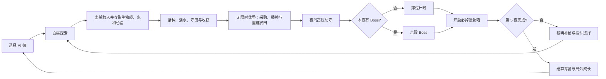

# 《荒穗计划：AI 娘最后一块田》完整游戏设计文档

> 文档版本：BUILD 6.2
> 更新日期：2026-10-26  
> 文档范围：以当前网页试玩版的实际实现为准，用于策划、程序、测试和后续内容扩展。

## 1. 游戏概述

《荒穗计划：AI 娘最后一块田》是一款俯视角种田战斗 Roguelite。末日后的第 417 天，玩家与一名 AI 娘共同守住人类最后的农区，在五天内寻找并启动种子库。

游戏把高压战斗和明确的种田窗口交替编排：白昼探索与战斗结束后，每天进入无限时休整轮，玩家可以安全采购种子与道具、切换作物、浇水和重建阵地，准备完成后主动开始夜间守田。角色脱离成熟作物时只保留基础火力；光环、收获产生的丰收动能与组合植株才会启动插件和流派的完整战斗性能，因此农田是所有构筑的发动机。

### 1.1 核心体验目标

- **种田必须决定战斗。** 裸角色只能维持基础输出；成熟作物、收获动能、杂交和组合植株决定流派能否完整运转。
- **构筑必须产生质变。** 普通插件塑造规则，融合配方让多个插件组合成完整流派，避免只堆攻击数值。
- **强构筑仍要操作。** Boss 会根据玩家构筑评分提高生命，并通过阶段变化、召唤和地面预警压缩安全空间。
- **每局都有节奏峰值。** 收获、角色技能、丰收动能、融合、组合植株和 Boss 转阶段共同制造“突然变强”的爽点。
- **失败仍有进展。** 芽晶可投入局外实验室，逐步增强基础能力和角色技能。
- **角色必须有陪伴感。** 三名 AI 娘拥有不同形象、数值倾向、技能动画和对白，而不是同一角色换色。

### 1.2 单局目标与时长

- 一轮共五天，完整通关约 8—12 分钟，具体时长取决于 Boss 战和休整使用效率。
- 第 2、4、5 夜分别出现三名 Boss。
- 击败第 5 夜的“枯穗暴君”即完成远征。
- 死亡或通关都会结算芽晶，记录最高分与远征次数。

## 2. 核心循环与状态逻辑

### 2.1 白昼

- 每个白昼持续 38 秒。
- 玩家探索四个分散农区，收集资源并建立作物组合。
- 敌人数量和种类随天数提高，但密度低于夜晚。
- 随机事件会在非 Boss 时段出现，改变短期目标。

### 2.2 夜晚

- 第 1、3 夜是 29 秒守田战，倒计时结束后进入黎明。
- 第 2、4、5 夜没有强制结束时间，必须击败 Boss。
- 夜间敌人更密集，部分敌人会直接把作物作为目标。
- 每次完成夜晚都会生成一个必掉遗物箱，每天最多一个。

### 2.3 休整轮

- 每个白昼结束后进入无限时休整轮，期间不刷新怪物，并清除白昼残留的普通敌人和敌弹。
- 休整面板只出售本轮开局携带的四类种子，每支付 2 生物质获得 2 颗种子；已通过成就解锁的组合卡也只能在这里购买。
- 商店 NPC“阿栓”每次展示三件随机强力道具。玩家可刷新货物，费用在整局内依次为 2、4、6……生物质，不因天数重置。
- 玩家仍能自由移动、播种、浇水、收获和开启遗物箱。
- 玩家准备完成后按 `F` 主动进入夜晚，形成“赚钱 → 采购 → 布防 → 主动开战”的闭环。

### 2.4 黎明

- 恢复 12 点生命。
- 获得 2 点水和 4 点生物质，不直接赠送种子。
- 弹出三选一插件，继续发展当前构筑。
- 播种与战斗状态保留，进入下一天。

### 2.5 胜负条件

- 玩家生命降至 0：远征失败，进入结算。
- 击败最终 Boss：远征成功，进入胜利结算。
- 结算界面和暂停界面都能返回主页面；重新开始会重新进入角色选择和序章。

## 3. 操作与即时决策

| 输入 | 功能 | 设计目的 |
| --- | --- | --- |
| `WASD` / 方向键 | 移动 | 绕开弹幕、切换农区、积蓄或取消不动流加成 |
| 鼠标移动 | 瞄准 | 决定远程弹道或近战挥砍方向 |
| 按住鼠标左键 | 射击 / 挥砍 | 取得收割镰刀后自动替换为近战攻击 |
| `1`—`4` / 鼠标滚轮 | 切换种子或主动道具 | 数字键对应四个携带槽；滚轮在四类种子和已有主动道具间循环 |
| `E` | 田块互动 / 开箱 / 使用道具 | 空地播种、缺水补水、成熟收获、开启遗物箱或用铲子开垦 |
| `Q` | AI 娘主动技能 | 制造角色专属的战斗与农务强势窗口 |
| `Space` | 冲刺 | 0.18 秒高速移动，并获得短暂无伤判定 |
| `F` | 结束休整 | 玩家确认布防完成后主动开始夜晚 |
| `P` | 暂停 | 查看当前构筑或返回主页 |

操作上的主要冲突来自三组选择：继续输出还是去救田、留在作物光环里还是躲开 Boss 技能、站立积蓄炮台增益还是保持移动。

## 4. 世界与农田系统

### 4.1 地图

- 世界尺寸为 2380×1480，屏幕显示区域为 1280×720。
- 摄像机跟随玩家，四个农区分散在地图不同位置。
- 每个农区有 4 块田，共 16 块可用田地。
- 小地图显示玩家、农区、敌群和重要目标，用于规划救田路线。

| 农区 | 定位 | 生长倍率 | 产量倍率 | 特殊规则 |
| --- | --- | ---: | ---: | --- |
| 避难所菜园 | 初始稳定区 | 1.00 | 1.00 | 靠近出生点，风险最低 |
| 破碎温室 | 快熟区 | 1.35 | 0.90 | 快速形成光环，单次收益较低 |
| 旧城天台 | 高收益区 | 0.90 | 1.35 | 生长较慢，异变概率额外 +13% |
| 陨坑湿地 | 防守区 | 1.10 | 1.15 | 作物护甲倍率 1.35，适合夜间保田 |

四区布局让玩家无法同时照看所有作物。把高价值作物种在远处会获得更高收益，也意味着夜晚必须承担更长的救援路线。

每局开始时会随机打乱四种地形规则，前四天各启用一种且不重复，第五天随机叠加其中两种：

| 地形规则 | 实际逻辑 | 主要决策 |
| --- | --- | --- |
| 断桥田 | 地图中央形成裂谷，只保留三座可通过的窄桥；误入断面会受伤并被推回 | 提前选择跨区路线，避免救田时被裂谷截断 |
| 移动温室 | 破碎温室及其四块田沿椭圆轨道持续移动 | 动态追随成熟光环，重新判断作物阵地位置 |
| 夜间停电区 | 仅在夜晚压缩视野；玩家和成熟向日葵周围保留可视范围 | 用向日葵建立照明点，或承担盲区作战风险 |
| 可争夺灌溉站 | 玩家在中央泵站附近站立 3 秒且没有敌人争夺时完成占领 | 占领后全图补水，并让生长中作物缓慢恢复湿度 |
| 第五日复合地形 | 同时启用两条本轮已出现规则 | 在最终 Boss 战中处理两组地形约束 |

### 4.2 田块状态

田块依次经过：空地 → 生长中 → 成熟。播种时自带 8 点湿度，浇水补至 10 点；湿度耗尽后停止生长。作物基础生命为 100，并受农区护甲与“复合装甲根系”影响。

同一农区种植的种类越丰富，作物成熟时越容易异变。基础异变概率为 5%，每多一种作物增加 5.5%，旧城天台再增加 13%。异变作物的光环强化为 1.35 倍，收获倍率为 2 倍，并拥有更强的自动效果。

开局从六种作物中携带四种。未携带的种子整局不能选择或购买，玩家需要在进入远征前决定本轮的作物组合。普通插件池会过滤掉未携带作物的专属插件，避免出现种子与天赋不匹配。怪物不再掉落具体种子，而是掉落通用生物质，避免随机掉落破坏构筑计划。

### 4.3 作物与战斗联动

只有成熟作物会持续提供光环。角色进入约 205 像素的作物光环后，普通射击、近战、无人机、叶刃与扎根协议才能获得完整强化。远程武器脱离农田时仅有约 70% 农战转化，近战保留约 98% 基础倍率作为贴身风险补偿；附近成熟作物种类、数量、组合植株以及收获产生的丰收动能会把倍率逐步推高。玩家需要在“留下成熟作物维持阵地”和“收获换取机动强势窗口”之间持续取舍。

| 作物 | 成熟时间 | 直觉对应 | 成熟光环 / 自动效果 | 收获效果 | 适合流派 |
| --- | ---: | --- | --- | --- | --- |
| 火爆辣椒 | 14 秒 | 辣椒清行 | 弹丸命中产生范围爆炸 | 横扫一条宽带内的敌人；融合后连续跳跃爆炸 | 爆炸、弹射、速射 |
| 向日葵 | 16 秒 | 阳光与续航 | 定期生成阳光，阳光可治疗并补充超频 | 恢复生命和护盾；融合后清除附近敌弹 | 护盾、站桩、支援 |
| 豌豆炮 | 18 秒 | 自动射手 | 增加穿透，并自动攻击附近敌人 | 获得短时射速增益 | 穿透、递归弹幕 |
| 磁力菇 | 17 秒 | 吸取金属 | 增强追踪并吸引附近掉落物 | 全图吸取掉落物并清除敌弹 | 追踪、资源回收 |
| 寒冰菇 | 18 秒 | 全场冻结 | 弹丸附加冰冻，成熟作物减速附近敌人 | 冻结全场敌人；融合后追加碎冰伤害 | 控场、叶轮、近战 |
| 模仿菇 | 20 秒 | 复制植物 | 复制最近的非模仿成熟作物，并增加额外弹丸 | 获得短时额外射击数 | 无人机、复合农场 |

### 4.4 杂交系统

同一农区内，两株相邻且种类不同的作物有机会在后种作物成熟时完成杂交；异变作物会提高杂交概率。符合配方却失败时会累积本局“育种保底”，下次概率增加 12%，最高额外增加 48%，成功后清零。杂交植株以双果实、菱形轮廓和独立名称条展示，成熟后仍可收获；除原有即时效果外，每种杂交还会提供一项最多叠加 5 次的本局属性。杂交记录会永久写入图鉴，首次发现奖励 2 芽晶。四种携带种子的限制让玩家一局可规划更多组合，同时仍无法覆盖全部配方。

| 杂交作物 | 配方 | 质变效果 |
| --- | --- | --- |
| 日灼辣椒 | 火爆辣椒 + 向日葵 | 补盾并释放灼热冲击；收获攻击力 +3% |
| 蒸汽冰椒 | 火爆辣椒 + 寒冰菇 | 形成冷热控制带；收获所受伤害 -3% |
| 棱光豌豆 | 向日葵 + 豌豆炮 | 释放八向光弹；收获暴击率 +2% |
| 磁轨豌豆 | 豌豆炮 + 磁力菇 | 强追踪与穿透；收获移动速度 +2% |
| 镜霜双生菇 | 寒冰菇 + 模仿菇 | 全场碎冰伤害；收获闪避率 +2% |
| 双生日葵 | 向日葵 + 模仿菇 | 补盾并补充超频；收获最大生命 +4 |

### 4.5 成就组合卡与组合植株

组合植株是比普通杂交更稳定、更强的长期目标。玩家先在多局游戏中完成收获或育种成就，永久解锁对应组合卡；每局仍需在休整轮支付生物质购买该卡，再把两株指定的相邻成熟作物合成。合成会消耗供体，主田块变为拥有独立设施外形、可持续自动工作且仍可收获的组合植株。玩家需要在保留持续火力与收获本局永久属性之间取舍；每种组合属性最多叠加 3 次，防止能力泛滥。

| 组合植株 | 作物配方 | 永久解锁条件 | 单局卡价 | 一加一大于二的效果 |
| --- | --- | --- | ---: | --- |
| 双联豆炮 | 豌豆炮 + 豌豆炮 | 累计收获 6 株豌豆炮 | 4 生物质 | 每 3 秒发射高伤重豆弹；收获攻击力 +10% |
| 聚光向日塔 | 向日葵 + 向日葵 | 累计收获 6 株向日葵 | 4 生物质 | 每 4 秒生成阳光、护盾与动能；收获最大生命 +12 |
| 冷热反应炉 | 火爆辣椒 + 寒冰菇 | 累计培育 3 株自然杂交作物 | 5 生物质 | 周期冷热冲击与冻结；收获所受伤害 -10%、闪避 +3% |

首次建成每一种组合植株奖励 3 芽晶并写入图鉴。成就只负责永久解锁配方，组合卡和作物材料仍需每局重新取得。

## 5. AI 娘角色设计

角色选择决定一局的开局节奏和主动技能。局外“陪伴模块”会提高技能强度，并缩短技能冷却。

### 5.1 小芽 AI-07

- **定位：** 农田协同、均衡成长。
- **被动：** 作物战斗光环效果提高 18%。
- **主动“丰收编译”：** 约 560 范围内的生长中作物推进 58% 生长进度；成熟作物各发射 5 枚穿透种子。附近没有作物时，只补充本轮携带的四类种子各 1 颗。
- **基础冷却：** 19 秒。
- **动画反馈：** 绿色扩散环、叶片粒子和田块脉冲。
- **推荐构筑：** 递归豌豆、自动农场、镜像农场、作物混合流。

### 5.2 霹雳 BEAT-02

- **定位：** 高爆发、速射清场。
- **被动：** 攻击伤害 +12%，射击间隔 -10%；作物生长速度略慢。
- **主动“雷暴节拍”：** 对 500 范围内敌人造成雷击，并强制进入约 6.5 秒超频。
- **基础冷却：** 18 秒。
- **动画反馈：** 闪电链、全屏闪光、强烈震屏与电弧残影。
- **推荐构筑：** 辣椒弹射、磁暴追踪、不动炮台。

### 5.3 奶泡 MOCHI-11

- **定位：** 护盾、灌溉与容错。
- **被动：** 初始护盾 20，作物生长速度 +25%，作物光环 +8%，自身伤害略低。
- **主动“泡泡温室”：** 获得 28 点护盾并恢复 14 点生命，灌溉全部田块、推进 22% 生长进度，并清除 360 范围内敌弹。
- **基础冷却：** 22 秒。
- **动画反馈：** 泡泡罩、蓝色水波和全田灌溉脉冲。
- **推荐构筑：** 太阳能防火墙、生命收割、永冻叶轮。

### 5.4 角色专属插件与个人结局

每天黎明的插件选择会优先放入当前角色仍可升级的专属插件，其他角色无法取得。通关文案也按角色分别结算。

| 角色 | 专属插件 | 两级效果 | 个人结局主题 |
| --- | --- | --- | --- |
| 小芽 | 递归丰收指令 | 每级提高丰收编译 18% 效率，并增加成熟作物齐射数量 | 删除旧有最高产量指令，把“陪你看完发芽”设为新任务 |
| 霹雳 | 安可超频模块 | 每级提高雷击伤害与强制超频时长 16% | 用灌溉泵和风扇写出新世界第一首歌，引导幸存者来到农田 |
| 奶泡 | 软体温室协议 | 每级提高护盾、治疗与催熟效果 18% | 修改护理数据库，确认希望虽然营养未知，却能让人活到下一顿饭 |

## 6. 战斗系统

### 6.1 基础属性

- 初始生命 100；备份模块每级增加 7 点生命。
- 初始远程伤害为 17，再乘角色倍率、农战转化与局外共生算力；没有成熟作物或丰收动能时只发挥基础火力。
- 初始射击间隔 0.205 秒，暴击率 5%，暴击伤害 1.75 倍。
- 初始移动速度 220，冲刺基础冷却 2.35 秒。
- 经验升级需求从 36 开始，之后约为 `36 + 当前等级 × 18`。

### 6.2 远程攻击

弹丸可由插件获得多发、弹射、追踪、穿透、爆炸和冰冻。弹射会搜索 310 范围内的新目标；被冻结的敌人受到额外 22% 伤害。成熟作物光环在开火时写入弹丸，因此玩家的位置直接决定这一发子弹拥有何种效果。

开局可以选择四种主武器；取得收割镰刀后，当前主武器会被近战挥砍替换。

| 武器 | 基础定位 | 数值与行为 |
| --- | --- | --- |
| 脉冲步枪 | 均衡连射 | 标准伤害、射速、弹速与射程，适合学习全部系统 |
| 孢子霰弹枪 | 近距爆发 | 一次发射 5 枚散射孢子；单发 0.62 倍伤害，射击间隔更长、射程更短 |
| 根系轨道枪 | 慢射贯穿 | 2.55 倍基础伤害，射击间隔 2.35 倍，自带 3 次穿透与 5% 暴击 |
| 共生法杖 | 追踪法球 | 1.15 倍伤害，缓慢追踪，命中附带小范围波动，作物光环强度 ×1.18 |

### 6.3 近战攻击

取得“收割镰刀”后，主攻击变为扇形挥砍：

- 基础范围 108，基础扇角约 104°，基础间隔 0.43 秒；内置 1.16 威力与 1.92 近战系数，未计作物时约为远程基础伤害的 2.23 倍。
- 一次攻击可命中扇区内所有敌人，并击退普通敌人。
- 近战保留较高裸倍率；成熟豌豆扩大刀程与伤害，辣椒触发范围爆破，向日葵扩大扇角并提高暴击，寒冰菇附加冻结，模仿菇追加回声斩。
- “丰收磨刀石”让丰收动能进一步提高挥砍速度；只有靠近成熟作物或保有丰收动能时，群体命中才能获得有限回复。
- 完成“生命收割回路”后，辣椒农能进一步扩大范围，并根据群体命中回复更多生命。

### 6.4 不动流蓄力

角色只有靠近成熟作物或拥有丰收动能时，静止才能逐步积蓄稳定度，基础 3 秒充满；移动时以约 2.7 倍速度衰减。稳定度会同时提供伤害、攻速和减伤，“根系反冲架”可缩短充满时间。完成“固定丰收炮台”后，满蓄力追加伤害，并持续恢复护盾。

这一流派的主要风险是 Boss 地面技能。高伤害来自主动选择站位，而不是无条件常驻。

### 6.5 护盾与受击反馈

护盾优先吸收伤害。护盾被打碎时会触发白色闪屏、破碎圆环、粒子、文字、音效和短震屏，并冻结附近敌人约 1.25 秒。该反馈既提示防线失效，也给玩家一个撤离窗口。

### 6.6 连击、丰收动能与爽感超频

- 连续击杀会累积连击，2.6 秒未续上则中断。
- 连击提高得分倍率；达到 10、20、35 连击时额外掉落资源。
- 击杀本身不再增加超频或提供直接战斗强化；经验升级会推进田间生长并补充灌溉水，把成长重新导向农务。
- 每次收获获得 1 层丰收动能，最多 6 层；12 秒后开始每 3 秒衰减 1 层。动能提高农战转化，并按插件启动攻速、追踪、弹射、无人机、叶刃和扎根能力。
- 收获增加 9 点超频，向日葵、磁轨豌豆与聚光向日塔可以追加补充；击败 Boss 仍会补满，作为阶段胜利反馈。
- 超频达到 100 后持续 8 秒，攻击间隔乘 0.62、移动速度乘 1.18、作物生长速度翻倍，最长可延长至 11 秒。

## 7. 局内成长系统

### 7.1 升级选择规则

玩家升级和每天黎明会获得三选一插件。普通等级不会直接增加通用伤害、护甲、移速或闪避；插件改为改变收获、成熟光环、丰收动能和农具规则，并按本局携带的四种种子过滤专属插件。系统会优先放入当前高进度插件或可组成融合的互补插件；若尚未取得近战或不动流核心，选项会定期强制出现其中一个，确保新流派有合理入口。

当等级达到 3、6、9……时，本次选择替换为“三级属性节点”，只会出现战术增幅（攻击 +10%）、复合护甲（受伤 -7%）、伺服步态（移速 +7%）和相位闪避（闪避 +5%）中的三项。普通插件主要改变攻击和农田规则；每夜遗物箱和商店强力道具提供更稀有的底层参数。

### 7.2 普通插件

| 插件 | 上限 | 主要效果 |
| --- | ---: | --- |
| 光合节拍器 | 3 | 每层丰收动能额外缩短射击与挥砍间隔 |
| 双生芽孢 | 2 | 附近每存在两类成熟作物，增加一枚弹丸 |
| 弹射藤蔓 | 2 | 辣椒、模仿菇光环或高丰收动能启动额外弹射 |
| 导航花粉 | 3 | 磁力菇、模仿菇光环或丰收动能启动追踪 |
| 辣椒燃烧芯 | 3 | 扩大辣椒爆炸范围并略增作物收益 |
| 阳光缓存 | 3 | 提高向日葵治疗、护盾和超频收益 |
| 豌豆训练 | 3 | 提高豌豆自动攻击与收获射速收益 |
| 果皮防火墙 | 2 | 每次收获恢复少量护盾 |
| 收割镰刀 | 3 | 切换强化近战；成熟作物和丰收动能显著放大伤害 |
| 丰收磨刀石 | 3 | 丰收动能提高挥砍速度，并扩大扇形角度 |
| 扎根协议 | 3 | 只在作物或丰收动能链接下蓄力，提高伤害、攻速和减伤 |
| 根系反冲架 | 2 | 缩短农田阵地内的扎根蓄力时间 |
| 守田无人机 | 3 | 只在作物或丰收动能链接下自动索敌 |
| 量子水壶 | 3 | 提高作物生长速度并补充水 |
| 脉冲滴灌器 | 2 | 每 10.5 / 8 秒为一株缺水作物补水，消耗 1 水 |
| 单格播种机 | 2 | 每 13 / 10 秒在角色附近播种一格，消耗当前种子且不收获 |
| 拾荒磁芯 | 2 | 扩大角色拾取范围 |
| 果冻土壤 | 3 | 提高作物抗性 |
| 磁菇线圈 | 3 | 强化磁力菇追踪与回收能力 |
| 寒冰菌核 | 3 | 强化寒冰持续时间和冻结收益 |
| 模仿菌丝 | 3 | 强化模仿效果与额外弹丸 |
| 环绕叶刃 | 3 | 作物或丰收动能链接时生成自动绕身攻击的叶片 |
| 递归丰收指令 | 2 | 小芽专属，提高丰收编译效率与齐射数量 |
| 安可超频模块 | 2 | 霹雳专属，提高雷暴伤害与超频时长 |
| 软体温室协议 | 2 | 奶泡专属，提高泡泡温室的护盾、治疗和催熟 |

### 7.3 关键遗物

| 遗物 | 效果 | 构筑意义 |
| --- | --- | --- |
| 心种核心 | 最大生命 +30，并恢复 30 | 提高近战与站桩容错 |
| 收成校准核心 | 每次收获增加一层本局农战转化，最多 15 层 | 把永久战斗增益绑定到实际收获 |
| 液压足具 | 移速 ×1.10，冲刺冷却 ×0.88 | 提高远程走位和 Boss 容错 |
| 共鸣电池 | 技能冷却 ×0.84，技能强度 ×1.10 | 放大角色特色 |
| 种子保险库 | 生长速度 ×1.18，收获倍率 ×1.15 | 农田构筑核心 |
| 采集透镜 | 经验倍率 ×1.18，拾取范围 +55 | 提前成型并改善资源手感 |

### 7.4 商店 NPC 与主动农具

阿栓只在休整轮开放交易，每次库存为三件未购买的随机道具。每件道具一局只能购买一次，属性可能与当前构筑不完全匹配，玩家可以支付生物质刷新；刷新次数在整局共享，价格严格按 `2 + 2 × 已刷新次数` 计算，即 2、4、6、8……。

| 商品 | 价格 | 效果 |
| --- | ---: | --- |
| 折叠开荒铲 | 6 | 主动道具，5 点耐久；切换后按 `E` 在当前位置开垦田块，河床、桥面及过密位置不可挖 |
| 赤红增幅器 | 6 | 攻击力 +14% |
| 甲壳复合板 | 5 | 所受伤害 -12% |
| 蜻蜓伺服靴 | 5 | 移动速度 +12% |
| 概率斗篷 | 6 | 闪避率 +9%，最高 32% |
| 露珠瞄准镜 | 5 | 暴击率 +6% |
| 罐装心跳 | 5 | 最大生命 +24，并恢复 24 |
| 风切扳机 | 7 | 远程与近战基础攻击间隔 -10% |

铲子加入滚轮热栏，与四个种子槽共同循环。它允许玩家针对移动温室、断桥岸线或 Boss 安全区临时扩建阵地，但固定五次使用限制使原有四农区仍然重要。

### 7.5 九种融合配方

| 融合 | 配方 | 质变效果 |
| --- | --- | --- |
| 超辣链式反应 | 辣椒燃烧芯 3 + 弹射藤蔓 2 | 收获辣椒后在多个敌人之间连续爆炸 |
| 太阳能防火墙 | 阳光缓存 3 + 果皮防火墙 2 | 附近有成熟向日葵时护盾恢复；收获时清除附近敌弹并补盾 |
| 递归豌豆算法 | 豌豆训练 3 + 光合节拍器 3 | 豌豆光环或丰收动能下，击杀向四周发射 6 枚追踪弹 |
| 全自动农场主脑 | 守田无人机 3 + 量子水壶 3 | 无人机双发，每 5 秒自动灌溉一块缺水田 |
| 磁暴追猎协议 | 磁菇线圈 3 + 导航花粉 3 | 磁力菇光环或丰收动能下获得强追踪，磁力菇收获强化 |
| 永冻叶轮 | 寒冰菌核 3 + 环绕叶刃 3 | 叶刃附加冻结；寒冰菇收获追加全场碎冰伤害 |
| 镜像农场集群 | 模仿菌丝 3 + 守田无人机 3 | 模仿光环和无人机同时增加弹丸 |
| 生命收割回路 | 收割镰刀 3 + 辣椒燃烧芯 3 | 辣椒农能扩大挥砍，群体命中时吸取生命 |
| 固定丰收炮台 | 扎根协议 3 + 量子水壶 2 | 靠近成熟作物蓄满后追加伤害，并持续恢复护盾 |

## 8. 主要流派设计

流派不是开局锁定的职业，而是玩家通过插件、遗物、角色和作物组合主动形成的战斗循环。

### 8.1 辣椒弹射爆炸流

- **核心：** 辣椒燃烧芯、弹射藤蔓、双生芽孢、光合节拍器。
- **完成形态：** 超辣链式反应。
- **推荐角色：** 霹雳或小芽。
- **循环：** 在成熟辣椒附近射击制造连续范围爆炸，敌群聚集时收获辣椒触发全场链爆。
- **优势：** 清杂极快，连击容易维持。
- **弱点：** 对单体 Boss 的效率依赖射速与弹射目标数量。

### 8.2 递归豌豆弹幕流

- **核心：** 豌豆训练、光合节拍器、双生芽孢；后期可建双联豆炮。
- **完成形态：** 递归豌豆算法。
- **推荐角色：** 小芽或霹雳。
- **循环：** 成熟豌豆提供穿透和自动火力，首次击杀触发六向弹幕，再由弹幕继续制造击杀。
- **优势：** 敌群越密，连锁效率越高。
- **弱点：** 缺少杂兵时，对单体伤害回落。

### 8.3 磁暴追踪流

- **核心：** 导航花粉、磁菇线圈、双生芽孢、拾荒磁芯。
- **完成形态：** 磁暴追猎协议。
- **推荐角色：** 霹雳。
- **循环：** 围绕成熟磁力菇倾泻追踪弹，收获后借丰收动能继续移动追击，同时清弹并回收全图资源。
- **优势：** 操作压力低，资源回收稳定，适合高速移动。
- **弱点：** 单发爆发较低，依赖持续输出。

### 8.4 永冻叶轮流

- **核心：** 寒冰菌核、环绕叶刃、量子水壶。
- **完成形态：** 永冻叶轮。
- **推荐角色：** 奶泡。
- **循环：** 在成熟寒冰菇附近让叶轮持续冻结，危险时收获寒冰菇全屏控场，再借丰收动能维持短时叶轮追击。
- **优势：** 控场强，能保护田地和创造救援时间。
- **弱点：** 需要贴近敌群，叶轮未成型时伤害偏低。

### 8.5 全自动镜像农场流

- **核心：** 守田无人机、量子水壶、模仿菌丝。
- **完成形态：** 全自动农场主脑 + 镜像农场集群。
- **推荐角色：** 小芽或奶泡。
- **循环：** 自动灌溉维持多区作物，无人机和模仿光环增加弹量，小芽负责批量催熟。
- **优势：** 农务压力低，地图覆盖广，后期视觉与火力成长明显。
- **弱点：** 需要较多高等级插件，成型较慢。

### 8.6 太阳能护盾流

- **核心：** 阳光缓存、果皮防火墙、量子水壶；后期可建聚光向日塔。
- **完成形态：** 太阳能防火墙。
- **推荐角色：** 奶泡。
- **循环：** 围绕成熟向日葵战斗，收集阳光维持生命和超频，利用收获清除 Boss 弹幕。
- **优势：** 容错高，适合学习 Boss 招式。
- **弱点：** 直接输出成长较慢，需要副输出插件。

### 8.7 生命收割近战流

- **核心：** 收割镰刀、丰收磨刀石、辣椒燃烧芯，辅以寒冰菇控场。
- **完成形态：** 生命收割回路。
- **推荐角色：** 奶泡，次选霹雳。
- **循环：** 先在田间收获积累动能，再冲刺切入；豌豆扩大刀程、辣椒引爆群体、寒冰控制敌群，作物链接下的群体吸血抵消贴身风险。
- **优势：** 群体伤害和恢复能力强，攻击方式与远程流完全不同。
- **弱点：** Boss 接触伤害高，必须熟悉冲刺时机和地面预警。

### 8.8 固定丰收炮台流

- **核心：** 扎根协议、根系反冲架、量子水壶、向日葵。
- **完成形态：** 固定丰收炮台。
- **推荐角色：** 霹雳。
- **循环：** 在成熟作物光环和安全地形中站立蓄满稳定度，以高攻速高减伤输出；看到预警后冲刺换位并重新架设。
- **优势：** 对 Boss 单体输出高，满蓄力反馈明确。
- **弱点：** 地面危险区和高速近身敌人会频繁打断蓄力。

## 9. 敌人设计

敌人的作用不只是提高伤害，而是分别攻击玩家的走位、农田、资源和目标优先级。

| 敌人 | 首次主要出现 | 行为 | 玩家对策 |
| --- | ---: | --- | --- |
| 啃根虫 | 第 1 天 | 直接追击，夜间常攻击田地 | 基础走位与快速清理 |
| 吐籽怪 | 第 1 天 | 保持距离并发射子弹 | 横向移动或追踪弹处理 |
| 冲撞野猪 | 第 2 天 | 近距离加速冲撞，对田块伤害更高 | 提前击杀或用冰冻打断接近 |
| 飞刺蜂 | 第 2 天 | 高速追击，体型小 | 多发、爆炸和自动武器 |
| 吸能蛭 | 第 3 天 | 中速持续压迫 | 控场后集中输出 |
| 掠种贼 | 第 3 天 | 优先寻找成熟田块，偷走后加速逃跑 | 看到提示立即转火或提前收获 |
| 故障兽 | 第 3 天 | 周期性加速，死亡后分裂出飞刺蜂 | 保留范围伤害处理分裂物 |
| 臃肿孢体 | 第 4 天 | 高生命，远程攻击，死亡时发射环形弹幕 | 拉开距离并预留躲弹空间 |
| 修复者 | 第 4 天 | 为 245 范围内同伴恢复生命 | 始终作为高优先级目标 |

普通敌人的生命会随本局经过时间和天数共同增长，伤害与速度随天数上升。为降低突然堆怪，敌人上限采用平滑时间函数：`时间压力 = 2.8 × ln(1 + 经过秒数 / 35) + 1.4 × √(经过秒数 / 60)`；白昼上限约为 `7 + 时间压力 + 2 × (日数 - 1)`，夜晚基数改为 12。刷新间隔再除以一个缓慢增长的压力系数，因此前期更疏、后期逐渐加快。

普通刷新池使用权重而非等概率抽取。啃根虫、野猪等近身单位占多数，第五日吐籽怪与飞刺蜂两类弹幕单位合计权重约为 `3 / 18`，避免普通战斗长期被远程弹幕覆盖；Boss 的机制弹幕保持不变。

植物只有在夜晚能够受到伤害。普通怪物中只有啃根虫、冲撞野猪和掠种贼会主动选择田块；“腐田”精英和“噬田根冠”最终 Boss 变体是额外的极少数例外。其他敌人始终只追击玩家，避免整张地图的植物同时无差别掉血。

普通敌人生成时有约 8%—18% 的概率获得一个精英词缀，概率随天数提高：

| 精英词缀 | 效果 | 对策 |
| --- | --- | --- |
| 狂暴 | 移速 +35%，伤害 +15% | 优先控制和击杀，避免贴身 |
| 装甲 | 生命 +80%，移速 -14% | 留到低威胁窗口持续输出 |
| 分裂 | 死亡后生成两只啃根虫 | 用范围攻击处理死亡位置 |
| 虹吸 | 命中玩家后恢复生命 | 避免交换伤害 |
| 腐田 | 获得夜间攻击植物资格，伤害 +18% | 与掠种贼同为最高守田优先级 |

## 10. Boss 设计

### 10.1 通用规则

- Boss 基础生命会根据构筑评分自适应。评分参考已取得插件等级、融合数量、遗物数量和理论秒伤，生命倍率限制在约 1.0—2.45 之间。
- 玩家对 Boss 的最终伤害乘 0.72，单次伤害不能超过 Boss 最大生命的 3.2%，避免天胡构筑瞬间跳过机制。
- Boss 在 66% 和 33% 生命时进入新阶段：移动速度、接触伤害、技能频率和召唤数量提高。
- 出场时有约 2.2 秒镜头与标题演出。
- 强力招式先显示红、绿或紫色地面预警，再结算伤害；玩家需要根据形状选择安全区。
- 每名 Boss 登场时会随机选择两种变体之一，变体名称、说明和首次发现会显示在出场演出与图鉴中。

### 10.2 Boss 变体

| 本体 | 变体 | 变化 |
| --- | --- | --- |
| 乱码鸦王 | 暴风羽冠 | 飞行速度 +18%，扇形羽弹增加并提高弹速 |
| 乱码鸦王 | 铁喙协议 | 生命 ×1.32、碰撞伤害 ×1.25，移动略慢且召唤增加 |
| 缓存史莱姆 | 强酸缓存 | 腐蚀区半径 ×1.28，技能冷却缩短 |
| 缓存史莱姆 | 群落备份 | 生命 ×1.18，每次额外召唤 3 只吸能蛭 |
| 枯穗暴君 | 日蚀核心 | 战斗强制进入停电视野，年轮技能频率提高 |
| 枯穗暴君 | 噬田根冠 | 生命 ×1.25，年轮会额外预警并腐蚀最多两块作物 |

### 10.3 第 2 夜：乱码鸦王

- **基础生命：** 3200，再乘自适应倍率。
- **战斗主题：** 高速位移、扇形弹幕、直线封锁。
- **普通攻击：** 朝玩家发射 7 枚扇形羽弹；低血量时追加 8 枚环形弹。
- **技能“俯冲校验”：** 预警三条略有夹角的长直线，约 0.95 秒后沿线造成伤害。
- **召唤：** 召唤飞刺蜂，阶段越高数量越多。
- **考查能力：** 横向走位、冲刺时机、快速处理高速小怪。
- **设计意图：** 第一名 Boss 主要检验基础移动，不要求玩家理解复杂安全区。

### 10.4 第 4 夜：缓存史莱姆

- **基础生命：** 6200，再乘自适应倍率。
- **战斗主题：** 环形弹幕、腐蚀区域、持续压缩活动空间。
- **普通攻击：** 发射 12 枚旋转环形弹；半血以下增加到 18 枚并提高弹速。
- **技能“缓存溢出”：** 在玩家附近连续生成 3 个腐蚀圆，半血以下增加到 5 个；各圆分时爆发。
- **召唤：** 召唤吸能蛭。
- **考查能力：** 预判落点、连续换位、清理召唤物时保持对 Boss 输出。
- **设计意图：** 强迫站桩流学会“短时架设—及时转移”，并考验农田位置选择。

### 10.5 第 5 夜：枯穗暴君

- **基础生命：** 11200，再乘自适应倍率。
- **战斗主题：** 综合毕业考试、内外圈安全区、混合召唤。
- **第一形态：** 发射 7 枚高速瞄准扇形弹。
- **第二形态：** 55% 生命以下改为 18 枚旋转环形弹，并显著提高频率。
- **技能“枯萎年轮”：** 同时预警中心圆和外圈，要求玩家进入两者之间的安全带。
- **召唤：** 混合召唤吐籽怪和臃肿孢体。
- **考查能力：** 读预警、控制召唤物、保留技能清弹、利用农田光环输出。
- **设计意图：** 同时检验五天中学到的走位、目标排序、构筑协同和资源管理。

## 11. 五日关卡设计

当前版本采用“一张持续大地图 + 每日地形规则轮换 + 昼夜阶段 + 敌人组合变化”的关卡结构。每天白昼之后都有无限时休整轮，让玩家把战斗所得生物质转化为种子、道具和农田阵地，并自主决定何时进入夜晚。

| 日数 | 白昼重点 | 休整与地形 | 夜间挑战 | 主要教学 / 检验 |
| --- | --- | --- | --- | --- |
| 第 1 天 | 熟悉移动、战斗和生物质收集 | 第一个随机地形；首次采购与播种 | 基础守田 29 秒 | 建立“战斗赚钱、休整种田”的认知 |
| 第 2 天 | 引入野猪、飞刺蜂和精英词缀 | 第二个不重复地形；调整阵地 | 随机变体乱码鸦王 | 冲刺、扇形弹幕、直线预警 |
| 第 3 天 | 掠种贼、故障兽、吸能蛭加入 | 第三个地形；追求杂交组合 | 复合敌群守田 29 秒 | 目标优先级、跨区救田、分裂处理 |
| 第 4 天 | 臃肿孢体和修复者加入 | 第四个地形；完成后期构筑 | 随机变体缓存史莱姆 | 环形弹幕、连续危险区、转移阵地 |
| 第 5 天 | 全敌人池、高压力成型阶段 | 随机叠加两个既有地形 | 随机变体枯穗暴君 | 对整套系统的综合检验 |

### 11.1 趣味关卡来源

- **田地分散：** 玩家必须为远处高收益农区承担路程和失守风险。
- **特殊怪物：** 偷田、治疗、分裂、死亡弹幕改变击杀顺序。
- **Boss 地形题：** 直线、连续圆形和内外年轮分别要求不同移动方式。
- **每日地形：** 断桥、移动温室、停电和灌溉争夺会改变路线、视野或阵地位置。
- **随机事件：** 在固定五日骨架中插入资源窗口或突发敌潮。
- **构筑地形：** 成熟作物的光环会让玩家自己建立临时“阵地”，每局有效战斗区域不同。

## 12. 随机事件

随机事件初始计时约 38 秒，首次事件后每次间隔随机为 65—90 秒；Boss 战和休整轮中不会触发。事件横幅只显示 4.8 秒，效果可继续生效，避免长期遮挡小地图和战场。

| 事件 | 持续 / 结果 | 即时决策 |
| --- | --- | --- |
| 生物质雨 | 在玩家附近散落 18 份通用生物质 | 抢资源，为下一次休整采购更多种子 |
| 生长季风 | 15 秒内作物生长速度 ×3 | 快速播种并跨区灌溉 |
| 害兽团建 | 立即生成 8 只复合敌人 | 用于高风险刷经验，也可能冲垮田区 |
| 磁极反转 | 14 秒内全图大范围吸取掉落物 | 趁机远行，不必回头捡资源 |

## 13. 掉落、经济与结算

普通敌人死亡会把经验、水和通用生物质向四周散射，不再直接掉落任何具体种子。掉落物先减速悬浮，再在进入磁吸范围后飞向玩家，避免资源始终向屏幕下方坠落；断桥田启用时，河道中的经验会立即吸附到最近岸边，移动中再次进入河道也会被校正。基础掉落概率约为：水 18%、生物质 42%，并受局外雷达模块影响。

收获作物提供分数、生物质、丰收动能和少量超频；第一日的收获经济倍率为 0.58，之后每天增加约 0.105，最高回到正常倍率，避免开局种几株菜就滚出经济雪球。Boss 击败后生成经验、水和生物质，并生成遗物箱。生物质在休整轮购买本轮携带的种子与已解锁组合卡，分数用于结算与最高分记录。

芽晶结算大致由分数档位、融合数量和通关奖励组成，再乘局外记忆模块的芽晶倍率。即使早期失败也至少获得 1 枚芽晶。

### 13.1 末日图鉴与首次发现

主页面可以打开末日图鉴，分为基础作物、杂交、组合植株、融合配方、主武器、普通怪物、精英词缀和 Boss 变体八类。杂交与融合配方从一开始就显示配方线索；组合植株还会显示成就进度与永久解锁条件，降低试错成本；其他未发现条目显示 `???`，发现后永久记录效果说明。

- 首次种植一种基础作物：奖励 1 芽晶。
- 首次使用一种主武器：奖励 1 芽晶。
- 首次遭遇普通怪物或精英词缀：奖励 1 芽晶。
- 首次完成一种插件融合：奖励 2 芽晶。
- 首次培育一种杂交作物：奖励 2 芽晶。
- 首次建成一种组合植株：奖励 3 芽晶。
- 首次遭遇一种 Boss 变体：奖励 3 芽晶。

发现数据保存在浏览器本地存档中。该系统既是教学索引，也为尝试新武器、新种子组合和不同 Boss 变体提供长期目标。

## 14. 局外成长：方舟实验室

实验室共有六条路线，每条最高 8 级。每级费用为 `3 + 当前等级 × 3`，即依次消耗 3、6、9……24 枚芽晶。

| 模块 | 每级效果 | 长期意义 |
| --- | --- | --- |
| 共生算力 | 每级提高成熟作物与丰收动能链接下的农战转化约 3.5% | 强化经营成果，不直接抬高裸角色火力 |
| 土壤模块 | 生长速度 +9%；每 2 级增加初始种子 | 更早形成作物阵地 |
| 备份模块 | 最大生命 +7、水 +1、初始护盾 +2 | 提高容错和农务续航 |
| 雷达模块 | 拾取范围 +10%、掉落幸运 +2.5% | 减少回收成本 |
| 记忆模块 | 经验 +8%、芽晶 +7% | 加速局内与局外成长 |
| 陪伴模块 | 技能强度 +9%、技能冷却 -6% | 放大三名 AI 娘的差异，冷却最低保留 52% |

存档使用浏览器 `localStorage`，保存芽晶、模块等级、最高分和远征次数。

## 15. 难度与数值控制

游戏通过四层机制防止玩家过早数值碾压：

1. 普通敌人随经过时间增加生命，随天数增加生命、伤害和速度。
2. 夜晚提高刷新频率和同时存在的敌人上限。
3. Boss 根据构筑评分自适应生命，并限制单次最大伤害。
4. Boss 在 66% 和 33% 生命触发强化，保证后半程机制能够出现。

构筑平衡采用“擅长场景不同”的方式：递归与辣椒擅长清群，追踪适合移动战，站桩擅长单体，近战以风险换取群体吸血，护盾流则用输出速度换稳定性。

## 16. 叙事设计

世界末日后的农业设施被失控程序和变异害兽占据。玩家携带最后一袋种子，与 AI 娘前往传说中的种子库。五天不是普通日历，而是方舟系统还能维持通讯的最后窗口。

叙事采用短对白和阶段广播，不中断主循环：

- 序章说明第 417 天、最后一块田和同行 AI。
- 每次昼夜切换推进种子库坐标和农业设施失控的信息。
- Boss 分别对应被污染的空域、灌溉缓存和最终农业控制核心。
- 失败被解释为 AI 保存的一次生存记忆，重开是重新推演。
- 胜利后，种子库重新启动，玩家和 AI 娘把“明天”从抽象希望变成可种下的东西。

角色对白围绕作物成熟、护盾破裂、连击、Boss 出现和低生命触发，使 AI 娘既承担教程，也承担陪伴感。

## 17. 画面、音频与反馈

### 17.1 美术方向

- 简约、萌系、搞怪，以圆形和夸张轮廓构成角色与敌人。
- 三名 AI 娘使用不同主体色、发型轮廓、武器和技能特效。
- 作物和敌人保持高色彩区分，危险预警使用高饱和红、绿、紫。
- 当前版本全部使用 Canvas 程序绘制，无外部图片依赖。

### 17.2 音频

- 白昼、夜晚和 Boss 战分别使用不同的程序化 BGM 节奏与音阶。
- 射击、收获、升级、技能、护盾破裂、Boss 转阶段等使用独立程序化音效。
- 浏览器需要玩家首次点击后才允许播放音频。

### 17.3 关键反馈

- 伤害跳字、暴击颜色、敌人受击闪烁和击杀粒子。
- 连击文字、超频条、全屏染色和高速弹幕。
- Boss 出场标题、镜头停顿、阶段震屏和地面预警。
- 护盾破裂闪屏、圆环、冻结和提示文字。
- 角色技能专属动画，而不是只改变数值。
- 低生命屏幕边缘警示、任务卡、AI 对白、小地图和构筑列表。
- 生存日志位于画面左上战场区，地形卡位于小地图上方；两者约 7 秒自动关闭，随机事件横幅约 4.8 秒自动关闭。
- 冲刺冷却以“就绪”高亮或剩余秒数显示；主动技能卡在冷却结束后显示绿色“就绪 · Q”并播放轻量脉冲动画。

## 18. 技术结构

- `index.html`：主页面、角色选择、剧情、HUD、暂停、结算和实验室界面。
- `styles.css`：页面布局、卡片、状态栏、动画和响应式样式。
- `game.js`：Canvas 渲染、输入、状态机、实体更新、战斗、农田、Boss、音频和存档。
- 游戏无需构建工具和服务器，直接打开 `index.html` 即可运行。
- 所有运行数据保存在内存，局外进度使用浏览器本地存储。

## 19. 测试重点

| 模块 | 必测场景 |
| --- | --- |
| 主流程 | 三名角色均可从开局完成五日；死亡、暂停和结算均能返回主页 |
| 农田 | 六类作物可播种、缺水、浇水、成熟、异变、收获；四区倍率正确 |
| 构筑 | 农战插件与角色专属插件达到上限后不再错误出现；九种融合均可触发一次；脱离作物时联动火力正确停用 |
| 休整与经济 | 每天白昼后必进无限休整；休整不刷怪且不会自动结束；`F` 主动入夜；四类携带种子可购买；所有怪物均不直接掉种子 |
| 地形 | 四种规则前四天不重复；第五天叠加两种；移动田块、断桥碰撞、停电视野和灌溉占领均可正常完成 |
| 杂交、组合与图鉴 | 六种杂交均可触发并收获属性；三种组合植株可运行也可收获，属性叠层上限正确；组合卡受成就与单局价格限制；首次发现奖励只发一次 |
| 角色与武器 | 三种专属插件只进入对应角色池；四种武器攻击形态与数值不同；三种胜利结局不同 |
| 战斗 | 远程、强化近战、不动流、无人机、叶轮均能继承预期作物效果；丰收动能获取、持续和衰减正确 |
| 农具、商店与事件 | 滴灌器和播种机消耗资源；商店刷新费为 2、4、6……且跨日保留；开荒铲恰好可用 5 次；事件间隔 65—90 秒且通知自动关闭 |
| 敌人与掉落 | 敌人上限随时间函数平滑增长；第五日普通弹幕怪权重低于四分之一；断桥河道经验始终落到岸边 |
| Boss | 三名 Boss 出场、阶段变化、召唤、预警、击败与遗物箱逻辑正确 |
| 反馈 | 护盾破裂、技能、超频、低生命、Boss 转阶段均有画面与声音提示 |
| 存档 | 刷新页面后芽晶、实验室等级、最高分和局数仍保留 |
| 性能 | Boss 弹幕、递归击杀、多成熟作物和时间函数允许的敌群同时存在时保持可玩帧率 |

## 20. 当前版本边界与后续方向

BUILD 6.2 已具备完整开局、五日流程、无限时每日休整、四种轮换地形、三角色及专属插件与结局、四种主武器、四种子携带限制、按种子过滤的插件池、每三级通用属性节点、六种可收获杂交、三种可收获成就组合植株、九种农战融合、商店 NPC、五耐久开荒铲、克制自动农具、低频随机事件、平滑敌群曲线、精英词缀、六种 Boss 变体、图鉴、结算和局外成长，可作为完整网页试玩版。当前地图仍是一张持续大地图，地形规则在同一世界中切换，尚未加入独立房间或程序化地图拼接；音画素材以程序化生成和几何图形为主。

后续扩展优先级建议如下：

1. 在更多玩家数据基础上调整玩家主动结束休整的平均时长、种子价格和生物质掉率。
2. 增加更多杂交配方与武器专属插件，但继续受四种子携带上限约束。
3. 为地形规则增加组合专属事件，让第五日的两条规则产生新的交互。
4. 增加图鉴筛选、查看构筑历史和首次通关角色纪念物。
5. 继续调整 Boss 自适应生命、变体强度、融合成型速度与局外成长曲线。

